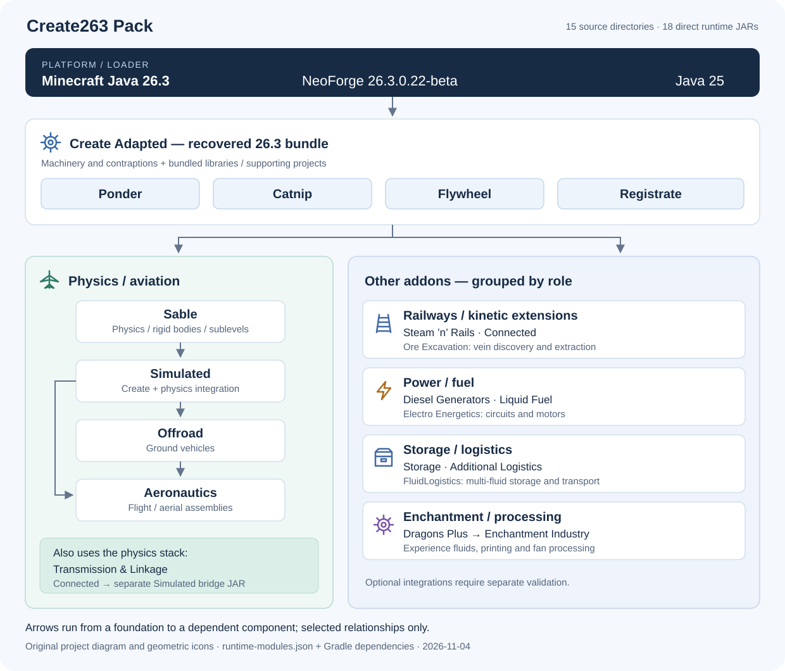

# Create263 Pack

[中文](README.md) · [English](README.en.md)

> **The code was generated through wish-based programming with GPT 6.1sol. Use it with caution. Only partial testing has been performed, and this experimental version is still unstable. Further testing will continue in actual worlds.**

An experimental Create modpack and source workspace for **Minecraft Java 26.3**, bringing together machinery, railways, physics assemblies, aviation, electricity, storage, fluid logistics and enchantment processing. Players can generate an HMCL import package with the installer. Mod port developers can inspect pinned upstream sources, reproduce builds and continue work on individual modules.

The current version is **0.3.0-alpha.3**, targeting **NeoForge 26.3.0.22-beta / Java 25**, with **15 source module directories and 18 direct runtime JARs**. This is a community port and integration project; component identities, authors and licenses are retained separately.

[Install](#install-with-hmcl) · [Features and architecture](#features-and-architecture) · [Build from source](#build-from-source) · [Validation scope](#validation-scope) · [Sources and licenses](#sources-and-licenses)

Download: [v0.3.0-alpha.3](https://github.com/Flowfangfei/create-263-modpack-public/releases/tag/v0.3.0-alpha.3) · [Release record](docs/RELEASE.md) · Last reviewed: **2026-11-04**.

## Install with HMCL

You need **Windows, Windows PowerShell, HMCL, Java 25** and an internet connection. The installer downloads pinned upstream resources; HMCL installs the matching Minecraft and NeoForge versions.

1. Choose the matching version under [Releases](https://github.com/Flowfangfei/create-263-modpack-public/releases) and download `Create263-Pack-v0.3.0-alpha.3-installer.zip` and `SHA256SUMS.txt`. Developers can also download `Create263-Pack-v0.3.0-alpha.3-sources.zip`. Check that the downloaded version matches this document.
2. Calculate the installer hash in PowerShell, compare it with the matching entry in `SHA256SUMS.txt`, then extract the entire installer.

   ```powershell
   Get-FileHash .\Create263-Pack-v0.3.0-alpha.3-installer.zip -Algorithm SHA256
   ```

3. Run `Install-Pack.cmd` from the extracted directory. The script verifies SHA-256 hashes for downloads and resource entries. On success it prints `HMCL import package created:` and creates:

   ```text
   output/Create263-Pack-v0.3.0-alpha.3-HMCL.zip
   ```

4. Import this **`-HMCL.zip`** into HMCL as a new instance and select **Java 25** for that instance. The `-installer.zip` contains the resource restoration tool and cannot be imported directly as an HMCL modpack.
5. Launch the new instance and create a new world. Keep the same modpack version and module set on the client and server. For an initial check, search for Create blocks in the creative inventory, open Ponder on an item that provides it, then place, power and observe a machine.

If you need an HTTP proxy, run this from the installer directory:

```powershell
.\Install-Pack.cmd -Proxy 'http://127.0.0.1:7890'
```

Replace the address with your proxy. Interrupted downloads are retried. If the output already exists, the script stops and preserves it. Keep any hash mismatch message and obtain the files for the matching version again.

The installer attachment excludes reserved-rights Aeronautics assets, the official Create artwork package and a separately licensed Diesel sound. It restores them locally from locked upstream sources. The complete HMCL package is generated on your computer; its assets retain their respective licenses. Keep the official Create asset JAR in the instance's `config/create-adapted/external-assets/` directory.

### Existing worlds

Back up the entire original instance and world first, retaining a recoverable copy. To try an existing world, **copy it into a new test instance**, check its mods, datapacks and configuration, then open the copy. Keep the original instance and world separately.

Tests use new worlds and hash-verified copies. Automatic migration of inventories from older Create Storage versions remains unverified. Check large inventories, old components and assemblies from other versions individually in a copy. The installer does not search for, copy or migrate existing worlds.

## Features and architecture



*Source: drawn for this project from the runtime manifest and Gradle dependencies. The gear, railway, flight and storage icons are original SVG geometry; no upstream logos or restricted assets are used. Arrows show the main dependencies represented here. Source code and mod metadata define the complete dependency graph.*

| Area | Main components | Purpose |
| --- | --- | --- |
| Machinery and demonstrations | Create Adapted, Ponder, Catnip, Flywheel | Kinetic machinery, processing, contraptions, in-game Ponder demonstrations and rendering support |
| Physics and aviation | Sable → Simulated; Offroad, Aeronautics | Rigid-body/sublevel foundations, physical machinery, ground vehicles and aviation assemblies |
| Railways | Steam ’n’ Rails | Create railways, trains and related components |
| Power extensions | Connected, Diesel Generators, Liquid Fuel | Kinetic components, diesel power and liquid-fuel input for blaze burners |
| Constraints and linkages | Transmission & Linkage | Universal joints, hydraulic linkages, hinges and Sable assembly constraints |
| Ore extraction | Ore Excavation | Vein location, sampling, drilling and fluid extraction |
| Electricity | Electro Energetics | Electrical circuits, motors and mechanical loads |
| Storage and logistics | Storage, Additional Logistics, FluidLogistics | Large private inventories, package handling, multi-fluid storage and transport |
| Enchantment processing | Dragons Plus, Enchantment Industry | Experience fluids, enchanting, printing and fan processing |

Ponder, Catnip, Flywheel and Registrate are supplied through Create's build/package system and are not additional direct JARs in the runtime manifest. Sable provides the physics foundation; Simulated integrates physical machinery, with Offroad and Aeronautics adding gameplay. Connected has a separate Simulated bridge JAR. Use the complete matching set to preserve the expected Create APIs and Flywheel runtime namespace.

Liquid Fuel retains upstream lava defaults and existing optional mappings. The test-only water fuel exists in a temporary validation datapack. See the [three-addon guide](docs/THREE-ADDONS-26.3.md) and [six-module migration guide](docs/FIVE-ADDONS-26.3.md) for introductory scenarios, fuel rules and module limits. These historical module documents are in Chinese.

### 15 source modules and 18 direct JARs

Paths below are relative to `modules/`. The [runtime manifest](manifests/runtime-modules.json) records exact artifact patterns and mod IDs; the [source manifest](manifests/sources.json) records upstream commits, reference branches and import hashes.

| Source module directory | Runtime JARs | Source and integration work |
| --- | --- | --- |
| [`create-adapted-263/`](modules/create-adapted-263/) | `create-adapted-recovered.jar` | AlexSensey/Create Adapted; recovered and adapted using public 26.2 source and differences in the 26.3 release binary |
| [`sable-adapted-263/`](modules/sable-adapted-263/) | `sable-adapted.jar` | LyXith/sable-port; adapted 26.3 physics foundation |
| [`create-aeronautics-adapted-263/`](modules/create-aeronautics-adapted-263/) | `simulated-adapted.jar`, `offroad-adapted.jar`, `aeronautics-adapted.jar` | LyXith/create-aeronautics-fly; three submodules referencing the adjacent Sable project |
| [`steam-n-rails-263/`](modules/steam-n-rails-263/) | `railways-adapted.jar` | zoom-packers/Create-Steam-n-Rails-Fly; railway port for 26.3 |
| [`create-connected-adapted-263/`](modules/create-connected-adapted-263/) | `connected-adapted.jar`, `connected-simulated-bridge.jar` | AlexSensey/create-connected-adapted; integration of the 26.3 branch and a physics bridge |
| [`create-diesel-generators-adapted-263/`](modules/create-diesel-generators-adapted-263/) | `diesel-adapted.jar` | AlexSensey/create-diesel-generators-adapted; configuration enum compatibility and integration with actual physics APIs |
| [`create-liquid-fuel-adapted-263/`](modules/create-liquid-fuel-adapted-263/) | `liquid-fuel-adapted.jar` | vibeported-mc/CreateLiquidFuel; port of pinned 26.2 source |
| [`create-ore-excavation-adapted-263/`](modules/create-ore-excavation-adapted-263/) | `ore-excavation-adapted.jar` | tom5454/Create-Ore-Excavation, with Jere655's port branch as an additional reference |
| [`transmission-linkage-adapted-263/`](modules/transmission-linkage-adapted-263/) | `transmission-linkage-adapted.jar` | userenxv/aeronautics-utility-objects, by enxv233; constraints and machinery adapted for 26.3 |
| [`create-dragons-plus-adapted-263/`](modules/create-dragons-plus-adapted-263/) | `dragons-plus-adapted.jar` | DragonsPlusMinecraft/CreateDragonsPlus; NeoForge feature tree combined with Fly 26.1.2 references |
| [`create-enchantment-industry-adapted-263/`](modules/create-enchantment-industry-adapted-263/) | `enchantment-industry-adapted.jar` | DragonsPlusMinecraft/CreateEnchantmentIndustry; NeoForge feature tree combined with Fly 26.1.2 references |
| [`create-electro-energetics-adapted-263/`](modules/create-electro-energetics-adapted-263/) | `electroenergetics-adapted.jar` | george8188625's official NeoForge feature tree combined with cat4blep's Fabric 26.2 port references |
| [`create-additional-logistics-adapted-263/`](modules/create-additional-logistics-adapted-263/) | `additional-logistics-adapted.jar` | KhloeLeclair/CreateAdditionalLogistics; port of pinned official source |
| [`create-storage-adapted-263/`](modules/create-storage-adapted-263/) | `storage-adapted.jar` | ausmez/create-storage-neo-forge; pinned official source and private inventory adaptation |
| [`create-fluid-logistics-adapted-263/`](modules/create-fluid-logistics-adapted-263/) | `fluid-logistics-adapted.jar` | yision1/CreateFluidLogistics; pinned official source and native fluid transaction adaptation |

## Build from source

You need **Python 3.11+, a Java 25 JDK** and an internet connection. The Gradle Wrapper baseline is **9.5.0**. Extract the matching `-sources.zip` completely, then run from the repository root:

```powershell
$env:JAVA_HOME = '<path to a Java 25 JDK>'
python -X utf8 -B scripts/bootstrap.py
python -X utf8 -B scripts/build.py --only all
python -X utf8 -B scripts/package.py
```

`bootstrap.py` restores local resources from the [resource lock](manifests/resources-lock.json) and stops if an existing file has changed. `bootstrap.py --check` only verifies resources. Full builds run serially in dependency order; a shared lock allows one Gradle writer at a time.

`package.py` checks the direct JAR set, Java package ownership and mod metadata, and uses `IsolateFlywheel.java` to handle runtime namespaces. The main outputs are:

| Path | Contents |
| --- | --- |
| `artifacts/runtime/mods/` | 18 local runtime/validation JARs |
| `artifacts/runtime/package-manifest.json` | Hashes of build inputs, runtime artifacts and stripped payloads |
| `artifacts/payload/mods/` | Installer payload with restricted assets removed |

After completing the relevant validation, generate the installer:

```powershell
python -X utf8 -B scripts/release.py
```

This creates `artifacts/releases/Create263-Pack-v0.3.0-alpha.3-installer.zip` and does not publish it to GitHub. Export the source archive from a fixed commit containing the latest source hash manifests:

```powershell
$sourceRef = '<Git commit containing complete source hash manifests>'
python -X utf8 -B scripts/source_archive.py --ref $sourceRef
```

The output is `Create263-Pack-v0.3.0-alpha.3-sources.zip` in the same directory; its version comes from the selected commit's modpack manifest. Export verifies individual source files using Git-normalized bytes and LF endings. Final release attachment hashes are recorded in `SHA256SUMS.txt` and the [release record](docs/RELEASE.md).

### Individual modules and local configuration

To rebuild the six addon modules, use `python -X utf8 -B scripts/build.py --only five-addons` after building their Create/Sable/Simulated dependencies. `five-addons` is the existing script group name and includes the Dragons Plus prerequisite. Run individual module tasks through the shared lock in `scripts/gradle_serial.py`, for example:

```powershell
python -X utf8 -B scripts/gradle_serial.py create-storage-adapted-263 build
```

Use `GRADLE_CMD` and `GRADLE_USER_HOME` to select Gradle and its cache. With a complete cache, set `CREATE263_GRADLE_OFFLINE=true`. Optional machine configuration belongs in the local-only `.local/config.json`:

```json
{
  "java_home": "<path to a Java 25 JDK>",
  "gradle_cmd": "<optional Gradle command>",
  "gradle_user_home": "<optional cache directory>"
}
```

On Windows, enable long paths when cloning: `git clone -c core.longpaths=true https://github.com/Flowfangfei/create-263-modpack-public.git`. For an existing checkout, use `git config --local core.longpaths true`. Verify the matching tag or commit when reproducing a release. Source ZIP extraction also needs a tool with long-path support.

## Validation scope

| Record | Observed results and limits |
| --- | --- |
| [2026-11-04 Ponder fixes](docs/PONDER-AUDIT-20261104.md) | 750 components and 1718 registrations scanned; 389 tasks deduplicated by scene, template and callback all rendered in the real GUI, with 3458 timeline samples and 38592 frames; all four batches saved, returned to the title screen and exited normally |
| Resource reload in the same audit | After an actual resource reload, pulley sprite assertions and rendering of the final 12 scenes passed; the tested combination contains 18 production JARs, and the test probe is excluded from the play package |
| [Earlier eighteen-JAR regression](docs/VALIDATION.md) | Four server probe groups on a new world and an independent JVM restart; 37 checks per phase for the six addon modules; recorded passes for model checks on 489 registered client items, ten GUI pages, real Storage clicks and compression-recipe network round trips |
| [Detailed gameplay tests](docs/GAMEPLAY-VALIDATION-26.3.md) | 29 new-world checks, 14 independent-restart checks and two normal shutdown checks; storage transactions/persistence, processing outputs/resource conservation, electrical loads and package acceleration timing |
| Installer validation for this version | Native Windows PowerShell 5.1 generated the HMCL package; every non-directory entry in all 18 JARs matched the tested set. All 1593 locked Aero resource targets were excluded from the attachment and restored correctly. See the [release record](docs/RELEASE.md) for digests. |

Each record applies to its stated version and inputs. The latest Ponder audit fast-forwards and samples selected timeline positions; it does not manually observe every naturally played frame. Complex production lines, moving sublevels, multiplayer, sustained load and uninstalled optional integrations still have untested areas. Sources or references for JEI, REI, EMI, KubeJS, ComputerCraft and JourneyMap do not establish that these integrations are installed or validated in this pack.

Ponder dynamic regression selects one representative per module and actual demonstration logic. Additional samples are retained where data formats, rendering paths, configuration branches or changed behavior materially differ. The complete registration index supports inexpensive static checks; affected groups and a small cross-module sample support regression after changes.

Before reproducing combined tests, configure independent `server_launch_template` and `client_template_directory` entries in `.local/config.json` for the fixed platform. The client template needs `launch-client.args`, dependencies and configuration. These templates require additional local preparation; game dependencies and test worlds are not supplied in the source archive. Then run:

```powershell
python -X utf8 -B scripts/gradle_serial.py runtime-probe jar
python -X utf8 -B scripts/package.py
python -X utf8 -B scripts/test_three_addons.py server
python -X utf8 -B scripts/test_three_addons.py client
```

The server creates an owned world under the project's `runtime/` directory and restarts in an independent JVM. The client uses a file-by-file hash-verified copy made after a normal save. See [mod upgrades and testing](docs/MOD-UPGRADE-AND-TESTING.en.md) for the porting workflow and validation levels. Historical detailed test reports remain in Chinese.

## Repository and documentation

| Path | Contents |
| --- | --- |
| `modules/` | 15 source modules; Create contains Ponder/Catnip/Flywheel, and the Aeronautics project contains three gameplay submodules |
| `vendor/`, `LICENSES/` | Registrate corresponding source, component licenses and third-party notices |
| `gradle/`, `scripts/` | Shared platform, resource restoration, serial builds, packaging and isolated validation |
| `manifests/`, `modpack/` | Provenance, hashes, resource locks, runtime module list and HMCL platform manifest |
| `tests/runtime-probe/` | Separate runtime probe source, excluded from the play package |
| `docs/`, `knowledge/` | Porting, fix and validation records, plus reusable technical notes |
| `artifacts/`, `runtime/`, `.local/`, `tooling/` | Local builds, test data, configuration and caches, ignored by Git |

- Start here: [sources and licenses](docs/SOURCE-AND-LICENSES.en.md), [mod upgrades and testing](docs/MOD-UPGRADE-AND-TESTING.en.md), [third-party notices](THIRD_PARTY_NOTICES.md).
- Module records: [Liquid Fuel](modules/create-liquid-fuel-adapted-263/docs/PORTING-26.3.md), [Ore Excavation](modules/create-ore-excavation-adapted-263/docs/PORTING-26.3.md), [Transmission & Linkage](modules/transmission-linkage-adapted-263/docs/PORTING-26.3.md), [Electro](docs/porting-notes/ELECTRO-26.3.md), [Storage and Additional Logistics](docs/porting-notes/STORAGE-LOGISTICS-26.3.md), [FluidLogistics](docs/porting-notes/FLUID-26.3.md), [Enchantment Industry and Dragons Plus](docs/porting-notes/ENCHANTMENT-DRAGONS-26.3.md).
- Fixes and validation: [main validation](docs/VALIDATION.md), [detailed gameplay](docs/GAMEPLAY-VALIDATION-26.3.md), [Ponder audit](docs/PONDER-AUDIT-20261104.md), [vent rendering](docs/VENT-RENDER-HOTFIX-20261029.md), [hot-air balloon flames](docs/PONDER-FLAME-HOTFIX-20261103.md).
- History and progress: [0.1 validation](docs/VALIDATION-v0.1.0-alpha.1.md), [0.2 validation](docs/VALIDATION-v0.2.0-alpha.1.md), [0.3 alpha.1 validation](docs/VALIDATION-v0.3.0-alpha.1.md), [release record](docs/RELEASE.md), [PROGRESS](PROGRESS.md), [TODO](TODO.md), [CHANGELOG](CHANGELOG.md).

When reporting a problem, include the pack version, Java/NeoForge versions, affected module, minimal reproduction steps and relevant logs. Remove account details, tokens and personal paths from shared logs. Reproduce world-related issues in a copy.

## Sources and licenses

Thanks to the original Create authors, upstream mod authors and port maintainers. This project retains pinned sources, attribution and modification records. See [sources and licenses](docs/SOURCE-AND-LICENSES.en.md), [THIRD_PARTY_NOTICES](THIRD_PARTY_NOTICES.md) and the [component license directory](LICENSES/) for the complete mapping.

The Create recovery uses **public 26.2 source as its baseline, combined with differences recovered from the 26.3 release binary**, followed by this pack's adaptations. It is unofficial recovered source. Original code, reverse-engineering references and assets retain their provenance and licenses; the whole repository cannot be labeled MIT.

Components individually use MIT, LGPL, GPL, AGPL, BSD, MPL, PolyForm Shield and other included terms. Read Sable's competitive-use restrictions, the CC-BY-NC and PolyForm Shield files accompanying Transmission & Linkage, and the reserved-rights Aeronautics asset terms individually. Code and asset licenses apply separately; local downloads through the installer do not change asset permissions.
