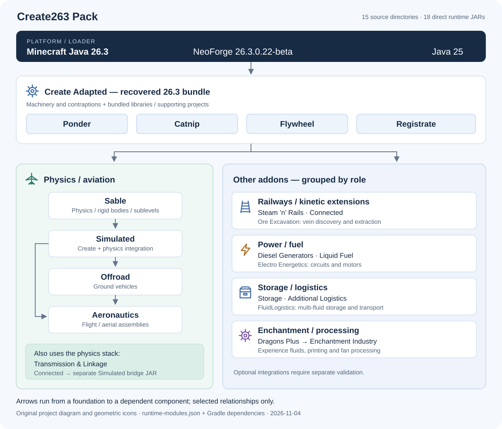

# Create263 Pack

[中文](README.md) · [English](README.en.md)

> **代码由GPT 6.1sol许愿式编程生成，请谨慎采用。仅进行了部分测试，实验性版本尚不稳定。后续将在实际存档中持续测试。**

面向 Minecraft Java **26.3** 的实验性 Create 整合包与源码工作区，整合机械动力、铁路、物理装配、航空、电力、仓储、流体物流和附魔加工。玩家可通过安装器生成 HMCL 导入包；模组移植开发者可查看固定上游来源、复现构建，并按独立模块继续适配。

当前源码版本为 **0.3.0-alpha.3**，平台固定为 **NeoForge 26.3.0.22-beta / Java 25**，包含 **15 个源码模块目录、18 个直接运行 JAR**。本工程是社区移植与整合，组件名称、作者和许可分别保留。

[安装](#安装到-hmcl) · [功能与架构](#功能与架构) · [源码构建](#从源码构建) · [验证范围](#已验证的范围) · [来源与许可](#来源与许可)

最后审核：**2026-11-04**（源码、清单、构建与安装脚本、已完成的验证记录）。本仓库用于发布清理后的独立公开源码快照；[原仓库](https://github.com/Flowfangfei/create-263-modpack)保留私有，其旧历史未导入。实际发布与附件见[发布记录](docs/RELEASE.md)及新仓库的 [Releases](https://github.com/Flowfangfei/create-263-modpack-public/releases)。

## 安装到 HMCL

准备 **Windows、Windows PowerShell、HMCL、Java 25** 和网络连接。安装器会下载固定上游资源；HMCL 负责安装对应的 Minecraft 与 NeoForge。

1. 在 [Releases](https://github.com/Flowfangfei/create-263-modpack-public/releases) 中选择对应版本，下载 `Create263-Pack-v0.3.0-alpha.3-installer.zip` 和 `SHA256SUMS.txt`。开发者另取同版 `Create263-Pack-v0.3.0-alpha.3-sources.zip`。确认下载版本与本文一致。
2. 用 PowerShell 计算安装器的哈希，与同版 `SHA256SUMS.txt` 中的条目比较，再完整解压安装器。

   ```powershell
   Get-FileHash .\Create263-Pack-v0.3.0-alpha.3-installer.zip -Algorithm SHA256
   ```

3. 在解压目录运行 `Install-Pack.cmd`。脚本验证下载文件和资源条目的 SHA-256，成功时显示 `HMCL import package created:` 并生成：

   ```text
   output/Create263-Pack-v0.3.0-alpha.3-HMCL.zip
   ```

4. 在 HMCL 中导入这个 **`-HMCL.zip`**，安装为新实例，并将该实例的 Java 设置为 **Java 25**。`-installer.zip` 是资源恢复工具，不能直接作为 HMCL 整合包导入。
5. 启动新实例，创建新世界试用。服务器与客户端应保持同一版本的模组组合；首次检查可在创造模式物品栏中搜索 Create 方块，打开可用物品的思索（Ponder）说明，并实际放置、供能和观察机器。

需要 HTTP 代理时，在安装器目录执行：

```powershell
.\Install-Pack.cmd -Proxy 'http://127.0.0.1:7890'
```

将地址改为实际代理。下载中断会重试；同名输出已存在时脚本停止并保留该文件。发生哈希不匹配时，请保留提示并重新获取对应版本的文件。

安装器附件剔除了航空学保留权利素材、Create 官方美术包和 Diesel 单独授权音效，由脚本从锁定来源在本地恢复。完整 HMCL 包在用户电脑上生成，其中素材仍受各自许可约束。Create 官方素材 JAR 位于实例的 `config/create-adapted/external-assets/`，请保留该位置。

### 使用已有存档

先完整备份原实例和存档，保留可恢复的副本。若要尝试旧世界，只将存档**复制到新的测试实例**，核对模组、数据包与配置后打开副本。原实例和原存档继续独立保存。

项目验证使用新建世界及其校验副本，未访问用户原存档。旧版 Create Storage 库存的自动迁移尚未验证；高数量库存、旧组件或其他版本的机械装配需要在副本上逐项检查。安装脚本不会查找、复制或迁移现有世界。

## 功能与架构



*图源：本项目依据运行清单和 Gradle 依赖自绘；齿轮、铁轨、飞行和仓储图标均为原创 SVG 几何图形，未使用上游 logo 或受限素材。箭头表示图中主要依赖方向，完整依赖以源码和模组元数据为准。*

| 内容 | 主要组件 | 用途 |
| --- | --- | --- |
| 机械与演示基础 | Create Adapted、Ponder、Catnip、Flywheel | 机械动力、加工、装配、游戏内思索演示与渲染支持 |
| 物理与航空 | Sable → Simulated；Offroad、Aeronautics | 刚体/子空间基础、物理机械、地面载具与航空装配 |
| 铁路 | Steam ’n’ Rails | Create 铁路、列车和相关构件 |
| 动力扩展 | Connected、Diesel Generators、Liquid Fuel | 传动构件、柴油动力及燃烧室液体燃料入口 |
| 约束与连杆 | Transmission & Linkage | 万向节、液压连杆、铰链及 Sable 装配约束 |
| 矿脉开采 | Ore Excavation | 矿脉定位、取样、钻井与抽液 |
| 电力 | Electro Energetics | 电路、电机与机械负载之间的连接 |
| 仓储与物流 | Storage、Additional Logistics、FluidLogistics | 大容量私有库存、包裹处理、多流体储存与输送 |
| 附魔加工 | Dragons Plus、Enchantment Industry | 经验流体、附魔、打印与风处理等加工 |

Ponder、Catnip、Flywheel 和 Registrate 随 Create 构建/打包体系提供，不另计为清单中的直接运行 JAR。Sable 是物理基础；Simulated 接入物理机械，Offroad 与 Aeronautics 在其上提供玩法。Connected 另有一个 Simulated 桥接 JAR。请使用同版完整组合，保留配套 Create 接口与 Flywheel 运行时命名空间。

液体燃料默认沿用上游熔岩规则及已有可选映射。测试中的“水燃料”只存在于临时验证数据包。上手场景、燃料范围及各模块限制见[三个附属说明](docs/THREE-ADDONS-26.3.md)与[六模块迁移说明](docs/FIVE-ADDONS-26.3.md)。

### 15 个源码模块与 18 个直接 JAR

以下路径均相对 `modules/`。精确产物模式及模组 ID 见[运行清单](manifests/runtime-modules.json)；上游提交、参考分支与导入哈希见[来源清单](manifests/sources.json)。

| 源码模块目录 | 运行 JAR | 来源与本包处理 |
| --- | --- | --- |
| [`create-adapted-263/`](modules/create-adapted-263/) | `create-adapted-recovered.jar` | AlexSensey/Create Adapted；以 26.2 公开源码及 26.3 发布包差异恢复、适配 |
| [`sable-adapted-263/`](modules/sable-adapted-263/) | `sable-adapted.jar` | LyXith/sable-port；26.3 物理基础适配 |
| [`create-aeronautics-adapted-263/`](modules/create-aeronautics-adapted-263/) | `simulated-adapted.jar`、`offroad-adapted.jar`、`aeronautics-adapted.jar` | LyXith/create-aeronautics-fly；三个子模块，并引用相邻的 Sable 工程 |
| [`steam-n-rails-263/`](modules/steam-n-rails-263/) | `railways-adapted.jar` | zoom-packers/Create-Steam-n-Rails-Fly；26.3 铁路适配 |
| [`create-connected-adapted-263/`](modules/create-connected-adapted-263/) | `connected-adapted.jar`、`connected-simulated-bridge.jar` | AlexSensey/create-connected-adapted；26.3 分支整合及物理桥接 |
| [`create-diesel-generators-adapted-263/`](modules/create-diesel-generators-adapted-263/) | `diesel-adapted.jar` | AlexSensey/create-diesel-generators-adapted；配置枚举兼容与实际物理 API 接入 |
| [`create-liquid-fuel-adapted-263/`](modules/create-liquid-fuel-adapted-263/) | `liquid-fuel-adapted.jar` | vibeported-mc/CreateLiquidFuel；固定 26.2 源码移植 |
| [`create-ore-excavation-adapted-263/`](modules/create-ore-excavation-adapted-263/) | `ore-excavation-adapted.jar` | tom5454/Create-Ore-Excavation，结合 Jere655 移植分支参考 |
| [`transmission-linkage-adapted-263/`](modules/transmission-linkage-adapted-263/) | `transmission-linkage-adapted.jar` | userenxv/aeronautics-utility-objects，作者 enxv233；26.3 约束与机械适配 |
| [`create-dragons-plus-adapted-263/`](modules/create-dragons-plus-adapted-263/) | `dragons-plus-adapted.jar` | DragonsPlusMinecraft/CreateDragonsPlus；NeoForge 功能树与 Fly 26.1.2 参考融合 |
| [`create-enchantment-industry-adapted-263/`](modules/create-enchantment-industry-adapted-263/) | `enchantment-industry-adapted.jar` | DragonsPlusMinecraft/CreateEnchantmentIndustry；NeoForge 功能树与 Fly 26.1.2 参考融合 |
| [`create-electro-energetics-adapted-263/`](modules/create-electro-energetics-adapted-263/) | `electroenergetics-adapted.jar` | george8188625 官方 NeoForge 功能树与 cat4blep Fabric 26.2 迁移参考融合 |
| [`create-additional-logistics-adapted-263/`](modules/create-additional-logistics-adapted-263/) | `additional-logistics-adapted.jar` | KhloeLeclair/CreateAdditionalLogistics；固定官方源码移植 |
| [`create-storage-adapted-263/`](modules/create-storage-adapted-263/) | `storage-adapted.jar` | ausmez/create-storage-neo-forge；固定官方源码与模组私有库存适配 |
| [`create-fluid-logistics-adapted-263/`](modules/create-fluid-logistics-adapted-263/) | `fluid-logistics-adapted.jar` | yision1/CreateFluidLogistics；固定官方源码与原生流体事务适配 |

## 从源码构建

准备 **Python 3.11+、Java 25 JDK** 和网络；Gradle Wrapper 基线为 **9.5.0**。获取同版本 `-sources.zip` 并完整解压，在仓库根目录执行：

```powershell
$env:JAVA_HOME = '<Java 25 JDK 路径>'
python -X utf8 -B scripts/bootstrap.py
python -X utf8 -B scripts/build.py --only all
python -X utf8 -B scripts/package.py
```

`bootstrap.py` 按[资源锁](manifests/resources-lock.json)恢复本地资源，遇到已有但内容改变的文件时停止；`bootstrap.py --check` 只核验。完整构建按依赖顺序串行执行，并通过共享锁保证同一时刻只有一个 Gradle 写入者。

`package.py` 检查直接 JAR 集合、Java 包归属和模组元数据，并通过 `IsolateFlywheel.java` 处理运行时命名空间。主要输出：

| 路径 | 内容 |
| --- | --- |
| `artifacts/runtime/mods/` | 本地运行与验证用的 18 个 JAR |
| `artifacts/runtime/package-manifest.json` | 构建输入、运行产物和剔除素材后的哈希 |
| `artifacts/payload/mods/` | 剔除受限素材的安装器载荷 |

完成对应验证后可生成安装器：

```powershell
python -X utf8 -B scripts/release.py
```

输出为 `artifacts/releases/Create263-Pack-v0.3.0-alpha.3-installer.zip`。该命令只打包，不发布到 GitHub。源码档案从包含最新源码哈希清单的固定提交导出：

```powershell
$sourceRef = '<包含完整源码哈希清单的 Git 提交>'
python -X utf8 -B scripts/source_archive.py --ref $sourceRef
```

输出同目录下的 `Create263-Pack-v0.3.0-alpha.3-sources.zip`；版本取自指定提交的整合包清单。导出会逐文件核对源码清单，使用 Git 规范化字节与 LF 换行。发布附件的最终摘要记录于 `SHA256SUMS.txt` 和[发布记录](docs/RELEASE.md)。

### 单模块与本机配置

仅重建新增六模块可用 `python -X utf8 -B scripts/build.py --only five-addons`，需要先构建其 Create/Sable/Simulated 依赖；`five-addons` 是沿用的脚本分组名，包含 Dragons Plus 前置。单模块任务通过 `scripts/gradle_serial.py` 进入共享锁，例如：

```powershell
python -X utf8 -B scripts/gradle_serial.py create-storage-adapted-263 build
```

可用 `GRADLE_CMD`、`GRADLE_USER_HOME` 指定 Gradle 和缓存；已有完整缓存时可设 `CREATE263_GRADLE_OFFLINE=true`。可选 `.local/config.json` 存放本机配置并保持本地：

```json
{
  "java_home": "<Java 25 JDK 路径>",
  "gradle_cmd": "<可选的 Gradle 命令>",
  "gradle_user_home": "<可选的缓存目录>"
}
```

Windows 使用 Git 获取源码时启用长路径：`git clone -c core.longpaths=true https://github.com/Flowfangfei/create-263-modpack-public.git`；已有检出可执行 `git config --local core.longpaths true`。复现发布版时应核对对应标签或提交，源码 ZIP 也需要支持长路径的解压工具。

## 已验证的范围

| 验证记录 | 实际结果与边界 |
| --- | --- |
| [2026-11-04 思索修复](docs/PONDER-AUDIT-20261104.md) | 750 个组件、1718 条注册完成扫描；按场景、模板与回调去重后的 389 场景全部完成真实 GUI 绘制，3458 次时间轴采样、38592 帧；四批正常保存、回标题并退出 |
| 同轮资源重载专项 | 实际调用资源重载入口后，绳轮 sprite 断言与末尾 12 场景绘制通过；最终部署的 18 个生产 JAR 与受测组合相符，测试探针未进入游玩包 |
| [已有十八模组回归](docs/VALIDATION.md) | 新世界与独立 JVM 重启的四组服务端探针；新增六模块每阶段 37 项；客户端 489 个注册物品的模型检查、十页 GUI 绘制、Storage 真实点击及压缩配方网络往返等已有通过记录 |
| [深入玩法](docs/GAMEPLAY-VALIDATION-26.3.md) | 29 项新世界检查、14 项独立重启检查及两次正常停服检查；涵盖仓储事务与保存、加工产物与资源守恒、电路负载和包裹加速时序 |
| 本版安装器验证 | 原生 Windows PowerShell 5.1 实际生成 HMCL 包；18 JAR 全部非目录条目与受测组合一致，1593 个航空学锁定素材目标在附件中排除并正确恢复；摘要见[发布记录](docs/RELEASE.md) |

这些记录对应各自标注的版本和输入。最新思索回归采用快进和时间点采样，未逐帧自然播放人工观察。复杂生产线、移动子空间、多人、长期负载和未安装的可选联动仍有待测范围。JEI、REI、EMI、KubeJS、ComputerCraft、JourneyMap 等联动的源码或参考存在，不代表它们已随本包安装或完成验收。

后续动态回归按模组和实际演示逻辑选一个代表；只有数据格式、渲染路径、配置分支或修复行为存在实质差异时增加样本。完整注册清单继续用于低成本静态检查，受影响组与少量跨模组场景用于修改后的回归。

开发者复现联合测试前，应在 `.local/config.json` 配置固定平台的独立 `server_launch_template` 和 `client_template_directory`。客户端模板须包含 `launch-client.args`、依赖及配置；模板属于额外本机准备，源码档案不附游戏依赖和测试世界。准备完成后执行：

```powershell
python -X utf8 -B scripts/gradle_serial.py runtime-probe jar
python -X utf8 -B scripts/package.py
python -X utf8 -B scripts/test_three_addons.py server
python -X utf8 -B scripts/test_three_addons.py client
```

服务端在项目 `runtime/` 下新建专属世界并独立重启；客户端使用正常保存后的逐文件哈希校验副本。详细的移植方法与验证层次见[模组升级与测试](docs/MOD-UPGRADE-AND-TESTING.md)。

## 目录与文档

| 路径 | 内容 |
| --- | --- |
| `modules/` | 15 个源码模块；Create 内含 Ponder/Catnip/Flywheel，航空学内含三个玩法子模块 |
| `vendor/`、`LICENSES/` | Registrate 对应源码、组件许可与第三方声明 |
| `gradle/`、`scripts/` | 共享平台、资源恢复、串行构建、打包与隔离验证 |
| `manifests/`、`modpack/` | 来源、哈希、资源锁、运行清单和 HMCL 平台清单 |
| `tests/runtime-probe/` | 独立运行时探针源码，不随游玩包提供 |
| `docs/`、`knowledge/` | 移植、修复与验证记录、可复用技术说明 |
| `artifacts/`、`runtime/`、`.local/`、`tooling/` | 本地构建、测试数据、配置与缓存，排除在普通 Git 交付之外 |

- 起点：[来源与许可详解](docs/SOURCE-AND-LICENSES.md)、[模组升级与测试方法](docs/MOD-UPGRADE-AND-TESTING.md)、[第三方声明](THIRD_PARTY_NOTICES.md)。
- 模块技术记录：[Liquid Fuel](modules/create-liquid-fuel-adapted-263/docs/PORTING-26.3.md)、[Ore Excavation](modules/create-ore-excavation-adapted-263/docs/PORTING-26.3.md)、[Transmission & Linkage](modules/transmission-linkage-adapted-263/docs/PORTING-26.3.md)、[Electro](docs/porting-notes/ELECTRO-26.3.md)、[Storage 与 Additional Logistics](docs/porting-notes/STORAGE-LOGISTICS-26.3.md)、[FluidLogistics](docs/porting-notes/FLUID-26.3.md)、[Enchantment Industry 与 Dragons Plus](docs/porting-notes/ENCHANTMENT-DRAGONS-26.3.md)。
- 修复与验证：[主验证](docs/VALIDATION.md)、[深入玩法](docs/GAMEPLAY-VALIDATION-26.3.md)、[思索专项](docs/PONDER-AUDIT-20261104.md)、[通风口渲染](docs/VENT-RENDER-HOTFIX-20261029.md)、[热气球火焰](docs/PONDER-FLAME-HOTFIX-20261103.md)。
- 历史与进展：[0.1 验证](docs/VALIDATION-v0.1.0-alpha.1.md)、[0.2 验证](docs/VALIDATION-v0.2.0-alpha.1.md)、[0.3 alpha.1 验证](docs/VALIDATION-v0.3.0-alpha.1.md)、[发布记录](docs/RELEASE.md)、[PROGRESS](PROGRESS.md)、[TODO](TODO.md)、[CHANGELOG](CHANGELOG.md)。

旧版本文档保留原私有仓库的发布与提交链接；访问这些历史链接需要原仓库权限。

反馈时请注明整合包版本、Java/NeoForge 版本、受影响模块、最小复现步骤和必要日志；分享日志前移除账户、令牌和个人路径。涉及存档的问题请在副本中复现。

## 来源与许可

感谢 Create 原作者、各上游模组作者及移植维护者。本工程保留固定来源、作者归属和修改说明，完整对应关系见[来源与许可](docs/SOURCE-AND-LICENSES.md)、[THIRD_PARTY_NOTICES](THIRD_PARTY_NOTICES.md)和[组件许可目录](LICENSES/)。

Create 恢复工程以 **26.2 公开源码为基线，结合 26.3 发布包的差异恢复**，再进行本包适配；它属于非官方恢复源码。恢复涉及的原始代码、逆向参考与素材继续保留其来源和许可，不能将整个仓库统一标为 MIT。

各组件分别适用 MIT、LGPL、GPL、AGPL、BSD、MPL、PolyForm Shield 及其他随附条款。Sable 的竞争用途限制、Transmission & Linkage 随附的 CC-BY-NC 与 PolyForm Shield 文件，以及航空学保留权利素材等需要单独阅读。代码许可与素材许可分别适用；安装器的本地下载流程不改变素材授权。
