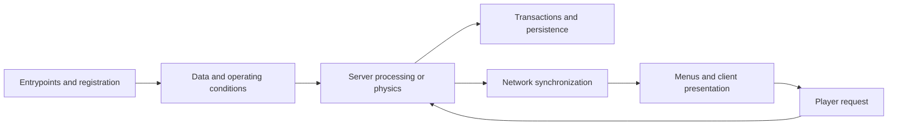

# Upgrading and testing Minecraft Java mods

[中文](MOD-UPGRADE-AND-TESTING.md) · [This project's development and implementation](DEVELOPMENT-OVERVIEW.en.md)

This guide covers building a target-version mod from available source, migrating loaders and dependencies, retaining gameplay and data semantics, and validating a mod combination. It applies to Fabric, Forge and NeoForge projects; check concrete APIs against the target version. Reviewed: 2026-11-04.

The sequence is provenance and feature baseline → source recovery → build and dependencies → lifecycle and conflicts → resources, storage, networking and physics → client behavior → layered validation and distribution. Sections follow engineering responsibilities; log length and test counts describe their respective evidence scopes.

## 1. Fix the target environment and a feature baseline

The migration boundary includes Minecraft, loader, Java, build plugins, mappings, dependency forks, physical client/dedicated server and optional integrations. Two Create forks for the same game version can expose different packages, base classes, registries, transactions and render APIs.

| Baseline | Record | Purpose |
| --- | --- | --- |
| Provenance | Repository, commit or identified working-tree snapshot, hashes, license and copyright | Distinguish upstream behavior, local changes and binary recovery |
| Platform | MC, loader, JDK, Gradle/plugins, mappings, required and embedded libraries | Reproduce compilation and actual class loading |
| Features | Registration, machine inputs/outputs, saves, menus, moving structures and integrations | Detect features that load but never become connected |
| Data | IDs, components, units, recipes, world data and supported legacy formats | Define migration and regression boundaries |
| Evidence | Old behavior, target artifact hashes, executed tests and remaining checks | Identify migration regressions |

Find the first missing result along an observable feature chain:



An available item establishes registration. Input consumption without output requires checking recipes and processing. Correct server state with an unchanged display requires checking synchronization and rendering. Establish that the old implementation supported the feature before calling a difference a regression.

## 2. Recover necessary changes from old source and newer binaries

Establish how source and releases relate. When public source predates a release, keep it as the maintainable base and use nearby and target binaries to narrow changes. Recovered code retains provenance and licenses and is identified as a rebuilt implementation.

1. Pin public source, comparison JAR and target JAR with versions and SHA-256; inputs also include embedded dependencies and mappings.
2. Compare class sets, fields and complete method descriptors. Separate real instruction/control-flow changes from symbols, compiler output, debug information and generated methods.
3. Decompile genuinely changed methods, read callers, exception handling, transactions and target APIs, then merge necessary changes into maintained source.
4. Check semantics behind familiar names: accepted versus remaining amounts, rollback on failure, and modifying copies versus original objects affect gameplay.
5. Map source class/method → local file → reason → compile/runtime evidence. Store decompiler output and analysis caches separately.

This project's Create recovery used public 26.2 / 0.996 source with 26.2 / 1.31 and 26.3 / 1.31 comparison inputs. Historical analysis classified 310 of 1,122 changed classes as involving real instruction, control-flow or method-set changes. Those counts belong to the fixed historical inputs, not subsequent builds. The public source archive does not include the complete original analysis cache. [Inputs and licenses](SOURCE-AND-LICENSES.en.md)

[ResourceHandlerItemAdapter](../modules/create-adapted-263/src/main/java/com/simibubi/create/api/contraption/storage/item/simple/ResourceHandlerItemAdapter.java) illustrates behavioral recovery: extraction respects the single-stack limit, and replacement commits only after complete extraction of the old item and insertion of the new one. A file-level compile and method-instruction comparison establish that local result. Whole-source builds and actual game behavior require separate later acceptance.

## 3. Align loaders, source sets, dependencies and production namespaces

A loader migration covers entrypoints, event buses, registration, resource capabilities, networking and services. Versions and TOML change declarations; runtime factories still need target implementations. A higher-MC Fabric reference and a more complete NeoForge feature tree can contribute changes by file and responsibility, with a retained feature checklist and provenance for each part.

| Layer | Inspect or change | Intended effect |
| --- | --- | --- |
| Build | Wrapper, plugins, toolchain, source sets, generated resources and exclusions | Compile target source and retain required resources |
| Dependencies | Forks, precise versions, signatures, compileOnly/implementation/Jar-in-Jar | Resolve the same compile/runtime contracts |
| Platform bridge | Entrypoints, events, ServiceLoader, capabilities and networking | Execute the former platform's behavior |
| Production archive | Foreign classes, duplicate packages, embedded libraries, reflection and resources | Prevent development-only success followed by production failure |

Directory names are clues; effective source sets decide. Old datagen and optional integrations can be retained separately, while enabled-feature claims follow the default runtime. Document runtime providers for compile-time stubs and exclude those stubs from releases. Production compatibility implementations retain semantics and licenses.

Dependencies sharing a name and version can still differ in ABI. Confirm Registrate parameter types from the actual JAR before preparing a dedicated compile bridge or aligning sources; leave shared global-cache artifacts intact. [Build entrypoint](../scripts/build.py), [shared platform](../gradle/create263-addon.gradle)

Embedded render-library migration covers classes, metadata and necessary resource references. Global replacement can damage shader subdirectories, regular expressions or identically named block IDs. This project uses structured [IsolateFlywheel](../modules/create-adapted-263/scripts/IsolateFlywheel.java), followed by [package checks](../scripts/package.py) rejecting foreign classes, unrelocated references and cross-mod split packages.

Build in dependency order, sharing real Create/Sable/Simulated outputs. Allow one writer to shared Gradle caches. Validate the foundation first, then add feature groups with identifiable changes.

## 4. Registration, sides, lifecycle and Mixin conflicts

Common registration, physical-client setup, server start/stop and world ticks have separate lifecycles. Resolve deferred suppliers at valid phases; register models, sounds and keys from client entrypoints. Common signatures, static fields and initialization can load client classes, so a runtime branch alone may not isolate them.

A visible machine and stored network data can still lack a server processor. Simulation needs real start, update and stop hooks; a missing executor can make downstream code return early. Let the normal game entrypoint start it, then verify output and shutdown cleanup. [Electrical lifecycle case](GAMEPLAY-VALIDATION-26.3.md)

For Mixin, check full descriptors, invocation sites, declared field types, ordinal, slice, locals and mappings. Another mod's overwrite may remove old injection points. Compatibility between Sable broadcast behavior and Railways camera positioning needed both subspace distance and camera position, rather than merely a successful injection. [Initial integration checks](VALIDATION-v0.1.0-alpha.1.md)

When disabling an injection, relaxing `require` or returning constant success, identify the behavior lost. Conditional compatibility also needs the base path without that dependency.

## 5. Items, fluids and energy: migrate operation semantics

Before replacing a handler, establish resource identity, units, capacity, direction, return semantics, simulation, commit and notification. Different components on the same ID can represent different resources. Capacity metadata and current contents also have separate meanings.

Every participant in one operation should agree through one transaction. The following is conceptual; implement it against the target API:

```text
Open a rollback-capable transaction
  Extract through the real container access
  Insert the corresponding resource into the destination
  If both accept fully: write back the container and commit
  If rejected, under-extracted or over capacity: abandon
Notify business logic after root commit
```

When backpacks or reusable containers store contents in components, exchange the result through the caller's real `ItemAccess`. Sided, controller and interface views of one physical backend share a snapshot; compression chains, filters, capacity and other derived state also roll back. [Container fueling](../modules/create-liquid-fuel-adapted-263/src/main/java/com/forsteri/createliquidfuel/core/BurnerStomachHandler.java), [backpack exchange](../modules/create-storage-adapted-263/src/main/java/net/fxnt/fxntstorage/inventory/StorageBackpackTransfer.java)

Read callers of older simulation protocols. Create mechanical arms observe a working copy's count change to infer simulated acceptance. Altering that temporary copy and committing the real world are separate actions. Forbidding every object mutation during simulation breaks that protocol.

For pure transfers, group by resource ID and components:

$$
Q_{\mathrm{initial}}+Q_{\mathrm{external\ input}}
=Q_{\mathrm{final\ contents}}+Q_{\mathrm{output\ or\ drops}}.
$$

Use the resource's fixed unit for $Q$; check fluid, energy, speed and torque against their APIs. Cover success, partial acceptance, rejection, root/nested rollback and sided automation. Failure controls for gameplay operations should begin with valid item states, rather than exceeding stack limits to satisfy an incorrect expectation. Deliberately malformed encodings belong to separate input-validation tests. [Actual failed-exchange case](porting-notes/FLUID-26.3.md)

## 6. Persistence and mod-owned inventories

Distinguish world saves, item components, networking, resource templates and temporary backups first. Modern ValueIO, Codec and template APIs require registry context. An old save method compiling does not establish that the engine still calls it.

Large storage separates item identity from logical amount: a count-one prototype retains components, and another field stores the mod quantity. Vanilla player inventories, chests, cursors and container components retain their own rules. This project uses `fxntstorage:storage_contents`; the proposed global count expansion was not adopted. [Private format](../modules/create-storage-adapted-263/src/main/java/net/fxnt/fxntstorage/inventory/StorageContents.java)

This only illustrates format design; implementation defines fields and limits:

```json
{"StorageFormat":1,"Size":1,"Entries":[{"item":{"id":"minecraft:diamond","count":1},"amount":4096}]}
```

Validate the complete version, slots, amounts and components before replacing live inventory. Migration identifies old sources, is idempotent and preserves unknown input instead of silently producing empty storage. Backpack tiers, tools, filters and exposed item slots have separate constraints.

Test blocks, item backpacks, drops/replacement, mounting/dismounting and disk reopen, comparing identity, components, amounts, filters and capacity. Memory round trips and independent JVMs are different evidence. New-format persistence does not establish automatic legacy-format migration.

## 7. Networking, menus and permissions

Check payload registration, both codecs, field order, registries, direction, thread, object identity and permissions. The server owns authoritative state; changing a client display alone does not implement machine behavior or recipe queries.

Storage sends private slots and initial state through mod messages, delegating player slots, cursor and dataSlots to the native synchronizer and retaining containerId, stateId, slot bounds and native click-hash checks. [Synchronizer](../modules/create-storage-adapted-263/src/main/java/net/fxnt/fxntstorage/inventory/StorageMenuSynchronizer.java)

Test opening, clicks, Shift clicks, dragging, backpack changes, reconnects and stale requests, comparing both sides and cursor state. Compression-recipe queries need actual request/reply through the current manager. Integrated-server protocol tests do not automatically cover remote dedicated-server transport.

For unavailable administrative commands, inspect environment, permissions, cheats and registration logs before attributing changes to the loader or a mod.

## 8. Recipes, tags, configuration and world generation

Follow generated/static JSON → conditions → Codec → manager → actual machine. Paths, Ingredient schemas, output components, loot, advancements and serializers can change. Compilation does not replace actual data loading.

| Problem | Change location | Behavior to verify |
| --- | --- | --- |
| Default components unbound | Deferred templates, construction and cache publication | Complete Stacks after registration |
| Missing recipes/loot | Datagen, static resources, conditions and serializers | Retain amounts, probabilities, tags and condition order |
| Old rules survive reload | Listeners, configuration reading and cache replacement | New rules appear; deleted rules disappear |
| Changed enums/defaults | Compatible reading and persistence | Explicit old-value handling, current defaults retained |
| Only an ore item exists | Features or virtual-vein data and conditions | Actual content in eligible new chunks |

A registered holder does not establish bound default components, and `CommonSetup.enqueueWork` does not substitute for checking the real sequence. Recipes can retain `ItemStackTemplate`/`FluidStackTemplate` and create Stacks at use time. Resource registries can freeze identity first, then validate and publish caches when components are available.

Liquid-fuel regression uses a temporary datapack, actual reload and old-rule removal. Water fuel is a fixture, not default gameplay. [Three-addon validation](VALIDATION-v0.2.0-alpha.1.md)

Ore blocks and virtual veins differ. The former uses configured/placed features and terrain hooks; the latter may use attachments, seeds and machine recipes. Ordinary generation applies to new chunks. Retrogen needs its own versions, idempotence, budget and interruption recovery. Pregeneration does not automatically migrate old data.

## 9. Physics systems and moving structures

Physics extensions involve server simulation, native libraries, local/world coordinates, identities, collision, attachment saves and client presentation. Check backend ABI, platform loading, services and threads. Empty implementations do not establish mechanical behavior.

Linkages need both physical bodies, local anchors and lifecycle. Splits, movement or merges may invalidate handles, requiring identity-based remapping and constraint rebuilding; disk reload also requires rebinding. [Linkage implementation and validation](../modules/transmission-linkage-adapted-263/docs/PORTING-26.3.md)

Subspace rendering and broadcast distance use their respective coordinate semantics. Compilation, visible models and working native constraints are separate claims. Start with finite states, gravity/collision, identities and constraints, then controlled propulsion or motion, and finally independent reload. [Foundation physics checks](VALIDATION-v0.1.0-alpha.1.md)

One propeller or hydraulic fixture covers that condition; complex loops, cross-dimension behavior and sustained multiplayer load remain separate tests.

## 10. Clients, rendering and demonstration environments

Check registration, state extraction, deferred submission, vertex formats, shaders, atlases and output targets. Capture data needed across phases and restore shared context after drawing. Worlds, items, moving structures and picture-in-picture can use different paths. This is migration guidance, not a claim that every old renderer has received the same refactor.

Files still need atlas entries and initialization timing. RGB-only colors can become transparent under ARGB; optional resources can load unconditionally without their mod. Test initial display and F3+T reload, waiting for asynchronous `Minecraft.reloadResourcePacks()` completion.

Ponder is one virtual environment: convert old templates at identified ID/field load boundaries, retaining new formats, unknown keys and conflicts. Keep backup compatibility at the backup boundary rather than altering world storage. Missing rotation sources and empty previous indexes need valid defaults.

Finite animation completion follows the actual controlled state, such as angular velocity rather than final angle; intentional backgrounds follow their design. Representative checks cover data, drawing, finite tails, logs and reload. Specific AIR, fluid/controller fields and render fixes are in the [Ponder porting details](PONDER-PORTING-NOTES.en.md), [Ponder topic](PONDER-AUDIT-20261104.md) and [flame pipeline](PONDER-FLAME-HOTFIX-20261103.md).

## 11. Validate in layers and select samples by risk

| Layer | Question | Evidence and boundary |
| --- | --- | --- |
| Provenance/diff | Where changes came from and what was recovered | Pinned inputs, method differences and sources |
| Compile/package | Source sets, ABI, metadata and namespace agreement | Builds and JAR/embedded-library checks |
| Combined launch | Physical sides and module conflicts | Registration, services and normal save/exit |
| Actual function | Correct inputs, conditions, processing, outputs and units | Natural ticks, conservation, transactions and native constraints |
| Network/persistence | Agreement across interaction, synchronization and reload | Menus, payloads, components and slots |
| Client | Models, GUI, animation and resource reload | Affected views, assertions and logs |
| Distribution | Restoring tested artifacts and corresponding source | Source hashes, installation and JAR entries |

This project expanded from nine foundation JARs to twelve and eighteen. Assembly/propulsion, pumping/drilling, constraint rebuilding, inventory/processing and real electrical loads answer different questions. The [development overview](DEVELOPMENT-OVERVIEW.en.md) maps stages to code and evidence.

Negative controls include no output without power, no consumption with blocked output, restored state after abandonment and resumed work after power returns. Electrical load tests exposed a missing simulator lifecycle that node/wire existence did not reveal. [Deeper gameplay](GAMEPLAY-VALIDATION-26.3.md)

For Ponder, select one representative per module/script/meaningful-parameter group; item/material aliases need no repetition. Different data, rendering, configuration or failure branches need appropriate samples. Transaction rejection versus commit, client versus server, and memory round trips versus independent JVMs remain separate conclusions within one mod.

Rerun affected groups plus a small cross-module set. Unrelated hashes update input records; broaden for material changes to shared interfaces, the framework or semantic groups. Record representatives, hashes, assertions, skips and uncovered branches.

Passing includes expected tasks, assertions, timeout checks, relevant logs and normal save/exit. Systems may catch exceptions and continue, so exit zero needs ERROR and content checks. Scope environment exclusions precisely. Programs, frames and checks do not add up to a percentage of functionality.

## 12. Locate code and missing behavior from symptoms

| Symptom | Inspect first | Change and validation |
| --- | --- | --- |
| Unsupported bytecode | Startup JDK and toolchain | Align build/run targets; start both sides |
| Missing field/method | Caller bytecode, real dependency and embedded libraries | Correct the full ABI and trigger the failed path |
| Split package | Production packages, bridge and assembly tasks | Separate packages; update reflection/registration |
| Frozen registry/empty supplier | Entrypoint, event bus and resolution order | Defer to a valid phase; first load/reopen |
| Server loads client classes | Common signatures, statics and constructors | Extract client implementation; dedicated-server launch |
| Missing Mixin target | Descriptors and other mods' overwrites | Retain both semantics; base/combined checks |
| A block does no work | Processors, ticks, recipes, configuration and outputs | Repair the first break; real inputs/outputs |
| Wires exist without power | Simulator lifecycle, threads and load | Natural ticks, power removal/restoration and shutdown |
| Resources lost/duplicated | Physical owners, snapshots, transactions and remainders | Shared transaction, conservation and rollback |
| Contents lost/menu rollback | Codecs, vanilla boundaries, payloads and state hashes | Whole-input validation, clicks/reconnect/restart |
| Reload ineffective | Schemas, conditions, dynamic registration and caches | Actual old/new rule replacement |
| Moving bodies lose links | Coordinates, identity, handles and attachments | Remapping, native motion and disk reload |
| Ore only in inventory | Features or virtual veins and conditions | Eligible new chunks; retrogen tested separately |
| Transparent/missing GUI/models | Registration, ARGB, atlases and conditional resources | Initial display, integration conditions and reload |
| Preview fails/animation never stops | Templates, extracted state, pipelines and stopping variables | Corresponding data/render representatives and tails |

## 13. Build and test entrypoints

Run generic diagnostics in the selected module or dependency context; the class is a target NeoForge example:

```powershell
java -version
.\gradlew.bat --version
$modJar = Read-Host 'Mod JAR path'
$dependencyJar = Read-Host 'Dependency JAR path'
Get-FileHash -LiteralPath $modJar -Algorithm SHA256
jar tf $modJar
javap -p -s -classpath $dependencyJar net.neoforged.fml.loading.FMLEnvironment
```

Use `javap -c` when invocation instructions matter. The target uses `FMLEnvironment.getDist()`; an old-field stub does not establish that field at runtime.

Full preparation is in the [README](../README.en.md#build-from-source). First build all modules and dependencies, then rebuild the affected module and probe and reassemble. Tests consume the assembled artifacts. These entrypoints also require Java 25, independent launch templates and fixtures:

```powershell
python -X utf8 -B scripts/build.py --help
python -X utf8 -B scripts/build.py --only storage
python -X utf8 -B scripts/gradle_serial.py runtime-probe jar
python -X utf8 -B scripts/package.py
python -X utf8 -B scripts/test_gameplay.py --help
python -X utf8 -B scripts/test_gameplay.py --group storage
python -X utf8 -B scripts/test_gameplay.py --group processing
python -X utf8 -B scripts/test_gameplay.py --group power-logistics
```

Configure `server_launch_template` / `client_template_directory` in `.local/config.json`; the source archive does not include worlds or client fixtures. Gameplay creates a world, saves/exits and reopens it in an independent JVM. Combined client checks also use [test_three_addons.py](../scripts/test_three_addons.py).

Ponder scans, representative indexes, reload commands and fixture prerequisites are in [Ponder porting details](PONDER-PORTING-NOTES.en.md).

## 14. Source, assets and reproducible distribution

Export corresponding source from a fixed commit, retaining upstream identities, copyright, component licenses and recovery inputs. Check code, references, natives and assets separately; reverse engineering or renaming packages grants no new permission. [Sources and licenses](SOURCE-AND-LICENSES.en.md)

Inspect all `assets/<namespace>/`, generated resources, embedded JARs, old dependencies and actual attachments, filtering by complete provenance boundaries and the resource lock. Submodule exceptions can override root `.gitignore`. Audit worktrees, tracked files, exported ZIPs and reachable history separately.

Connect build-input, runtime-JAR, installer-payload and restored-output hashes. Verify canonical Git source bytes file by file and execute the installer before comparing all effective JAR entries. Compression/timestamps can change archive hashes; equivalence reports still identify actual differences.

Record version/commit, tested combinations, format/migration scope, established behavior and remaining tests. Use new worlds or authorized copies with hashes and pre-migration checkpoints. Worlds, machine configuration, caches and collaboration records stay outside normal distribution. Roll back from pre-upgrade backups rather than handing newly written world formats directly to an older version.
