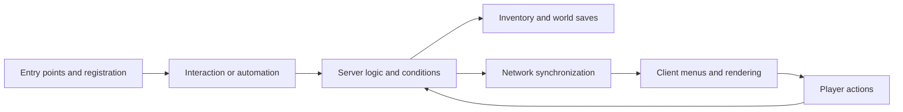

# Upgrading and testing Minecraft Java mods

[中文](MOD-UPGRADE-AND-TESTING.md)

This guide covers migrations across Minecraft, loader, and dependency versions for maintainers of Java mods, libraries, and mod combinations. Examples come from a Minecraft 26.3 / NeoForge migration; verify API names and lifecycle rules against the target version. The documentation baseline is 2026-11-04, and the project examples correspond to `0.3.0-alpha.3`. See the [release notes](RELEASE.md) and [third-party notices](../THIRD_PARTY_NOTICES.md) for actual distribution, repository visibility, and source licensing.

## 1. Establish the migration boundary and functional baseline

Record a working old combination, then pin the target combination. Compilation usually establishes Java type compatibility and whatever checks the executed build tasks perform. Registration, class loading, persistence, networking, and rendering require runtime evidence.

| Area | What to record |
| --- | --- |
| Game and loader | Exact Minecraft and Fabric / Forge / NeoForge versions; physical client and dedicated server |
| Java and build | JDK, Gradle wrapper, plugins, mappings, compilation target, and tasks actually executed |
| Dependencies | Upstream or fork, commit or version, origin, SHA-256, required or optional, compile time or runtime |
| Packaging | Source sets, exclusions, Mixin configuration, metadata, nested JARs, duplicate classes and resources |
| Configuration and data | Defaults, server configuration, resource/data pack priority, and previous storage formats |
| Functional baseline | Working recipes, machines, storage, moving structures, client behavior, world generation, and compatibility combinations |
| Test worlds | New world or authorized copy, origin, configuration, seed, and hash manifest for the copy |

Start with an observable feature and trace its callers, execution side, and conditions:



For a machine that produces nothing, distinguish a missing recipe, unavailable inventory access, insufficient power, an unregistered processor, a missing tick, and blocked output. A registered block establishes only part of this chain. Confirm that the old version supported a feature before recording the difference as a migration regression.

## 2. Identify the code actually compiled, packaged, and loaded

Check build scripts, source sets, generated sources, exclusions, mod metadata, and the final JAR in that order. Directory names provide clues: a multi-loader project may compile `src/neoforge/java` into the target package while retaining a similarly named `src/main/java` file for another platform or reference. Editing an excluded copy leaves runtime behavior unchanged.

Verify that loader entry points, registration buses, Mixin configuration, and optional integration entry points reach the package. Required dependencies need appropriate version ranges. Record `compileOnly` dependencies, compatibility stubs, and local replacements separately from actual runtime dependencies. Nested JARs also participate in class resolution; inspect duplicate classes, service descriptors, Mixins, and resource overrides.

Runtime `NoSuchFieldError`, `NoSuchMethodError`, and `AbstractMethodError` failures point to binary interface differences. Compare caller bytecode with the fields, method descriptors, staticness, and visibility in the loaded dependency. A matching source method name can still hide different parameters, return types, or a field replaced by a method.

One observed migration failure involved `FMLEnvironment.dist`, replaced in the target loader by `FMLEnvironment.getDist()`. A compatibility stub exposing the old field allowed compilation, followed by a crash when client audio executed. This example illustrates the target-version call; a client execution wrapper must still preserve lazy evaluation and physical-side isolation:

```java
// Example: confirm that the target loader actually provides getDist().
if (FMLEnvironment.getDist() == Dist.CLIENT) {
    factory.get().run();
}
```

A fix to this call should retain existing server start, stop, and simulation lifecycle behavior. Replacing similarly named helpers throughout other modules or changing tick registration expands the verification scope. [Actual client execution wrapper](../modules/create-electro-energetics-adapted-263/src/neoforge/java/com/george_vi/electroenergetics/foundation/ClientExecution.java)

Mixin migrations also require the complete target descriptor, `@At`, ordinal, slice, local variables, and declared field types. An accessor should match the declared type. Relaxing `require` or disabling remapping can silently lose an injection. Changes to inheritance or timing require a new check that the injection still implements the intended behavior.

## 3. Registration, execution sides, and dependency lifecycle

Separate common registration, server logic, physical client registration, and world-instance lifecycle. An integrated server still has a logical server thread. Code that starts in a single-player client may fail when a dedicated server loads a client class. Enter client-only code through the loader's client entry point, and inspect indirect client references in common static initialization.

Registration commonly uses deferred suppliers. Resolve them only after the relevant registration phase permits it. Early caching, manually unfreezing registries, or duplicate registration can obscure an ordering defect. Verify model, renderer, menu, receiver, capability or resource handler, and machine tick registration individually; one successful registration does not establish the others.

A block entity can restore data before its `level` is bound. Restore the data first, then perform world queries, light recalculation, and neighbor notifications after world binding. Confirm that this also runs on reload. For network handling, check direction, thread, server permission, and the identity of the current menu or entity.

Test optional dependencies both absent and present. Run A with its minimum dependencies, B with its minimum dependencies, then A+B to narrow dependency and Mixin conflicts. Adapters must retain the original contract, including accepted quantity versus remainder, simulation, commit, rollback, and directional restrictions.

## 4. Inventory migration: bound mod-owned quantities

Large inventories should distinguish item identity from logical quantity. Identity includes the registry ID and components. A mod-owned field stores quantities above ordinary stack limits, while vanilla item stack codecs, player inventories, chests, menu slots, and container components retain their respective constraints. Changing a global vanilla codec, stack limit, or all menu synchronization to accommodate one mod affects unrelated storage and networking paths.

This simplified private format keeps an ordinary item prototype at count one and stores logical quantity in `amount`. It applies only to the mod that declares the format:

```json
{
  "StorageFormat": 1,
  "Size": 1,
  "Entries": [
    { "item": { "id": "minecraft:diamond", "count": 1 }, "amount": 4096 }
  ]
}
```

On read, validate the format version, slot range, entry count, quantity bounds, and agreement between an empty prototype and zero quantity. Preserve components and slot order on write. Legacy migration needs explicit source detection and idempotence. Report and retain unknown versions or conflicting data rather than treating them as an empty inventory. Verify registry context and size limits separately for persistence and network codecs. [Private format implementation](../modules/create-storage-adapted-263/src/main/java/net/fxnt/fxntstorage/inventory/StorageContents.java)

Menu synchronization must handle mod-owned quantities alongside vanilla player slots, the carried stack, and remote state hashes. Keeping quantity transfer within its designated path while preserving ordinary slot synchronization reduces item rebound during dragging, Shift-clicking, or reopening. [Menu synchronization implementation](../modules/create-storage-adapted-263/src/main/java/net/fxnt/fxntstorage/inventory/StorageMenuSynchronizer.java)

Inventory changes should cover at least these states:

- Empty inventory, ordinary quantities, capacity boundaries, and quantities above a normal stack; filters, component-bearing items, and distinct items with similar IDs.
- No state change during simulation; correct quantities after commit; clear item ownership after rejection, partial acceptance, blocked output, and rollback.
- Automation from each direction, direct interaction, Shift-clicking, dragging, the carried stack, and vanilla player inventories and chests.
- Save and exit, complete process termination, and reopen in an independent JVM. Compare identities, components, quantities, slots, and filters. Verify client menus and server persistence separately.

For pure transfers, check conservation grouped by item ID and components:

$$
Q_{\mathrm{initial}}+Q_{\mathrm{external\ input}}
=Q_{\mathrm{final\ inventory}}+Q_{\mathrm{output\ or\ drops}}.
$$

For processing, list consumption and each output according to the recipe. Quantity tests should include overflow boundaries. Convert fluid units only after establishing both sides' unit contracts; capacity metadata and actual contents are separate values.

## 5. NBT, data components, and Ponder virtual worlds

World saves, network packets, resource templates, and Ponder's in-memory backups can use different formats. Identify the data origin and read/write chain before choosing an adaptation boundary. Legacy NBT in a resource template can be converted at template loading. This usually needs no change to real block entity saves or general item and fluid codecs.

A reviewable adapter constrains registry IDs, fields, legacy signatures, and allowed keys, and produces the same result when run again. Preserve valid modern data, unrelated additional data, and conflicting representations for reporting and further handling. These are confirmed examples; their field rules should not become global NBT replacements:

| Origin and symptom | Scoped conversion | What must be preserved |
| --- | --- | --- |
| A legacy large-inventory template fails decoding | Generate the private format only for confirmed inventory IDs and legacy fields | Slots, actual quantities, item components, filters |
| Mechanical arm or brass tunnel fails to deserialize AIR | Only in `create:mechanical_arm/HeldItem` and `create:brass_tunnel/StackToDistribute`, replace an old stack with `{}` when its only keys are `id` and `Count`, its ID is `minecraft:air`, and its integral count is 0 or 1 | Non-AIR items, modern formats, extra keys, other counts, conflicting data |
| Legacy fluid fields differ from the target format | Convert IDs, quantities, and components for confirmed containers and fields | Potion effects, bottle type, original quantity; treat capacity separately |
| Controller position or material structure changes | Adapt only confirmed block entity IDs and fields | Position semantics, direction, material identity, unrelated metadata |

The [legacy item placeholder adapter](../modules/create-aeronautics-adapted-263/simulated/src/main/java/dev/simulated_team/simulated/ponder/LegacyPonderTemplateItems.java) implements the AIR rule above. If Ponder backup creation emits an old structure again, apply the same constrained handling at its own in-memory backup boundary. The [backup adaptation entry point](../modules/create-aeronautics-adapted-263/simulated/src/main/java/dev/simulated_team/simulated/mixin/new_ponder/PonderLevelBackupMixin.java) leaves real-world save behavior intact.

Static tests can enumerate templates, compare fields before and after conversion, verify unknown-format preservation, and check repeated conversion. Dynamic tests must also exercise virtual-world restoration, script mutations, camera rendering, and backup restoration. Ponder can manually set kinetic speed without a real source. A neutral rendering factor for a confirmed source-less state, while retaining the sourced calculation, can address that display case without changing the global kinetic network.

## 6. Rendering migrations: pipelines, PiP, and texture lifecycle

Trace extraction, submission, vertex writing, materials, atlases, and output targets. Deferred rendering should use a snapshot for that frame; mutable objects may change between submission and drawing. Vertex format, shader inputs, samplers, uniform bindings, blending, depth, culling, and output attachments form a shared contract.

The main world, item previews, Ponder, and other picture-in-picture (PiP) targets can provide different attachment counts. Testing only the main world can miss pipeline validation failures in preview windows. One 26.3 flame pipeline required color outputs that matched the targets actually supplied by both the main world and PiP; copying another pipeline's multiple-target layout caused a mismatch. [Target-version pipeline example](../modules/create-aeronautics-adapted-263/aeronautics/src/main/java/dev/eriksonn/aeronautics/index/client/AeroRenderTypes.java)

A texture file also needs sprite shift registration and atlas loading. If a shift is lazily initialized during its first render after atlas stitching, `SpriteShiftEntry.getOriginal()` can remain null. The observed rope failure was fixed by calling `SimSpriteShifts.init()` early in the physical client constructor. Existing Catnip atlas events continue updating sprites on resource reload. A dedicated server does not load that client entry point. [Client initialization](../modules/create-aeronautics-adapted-263/simulated/src/neoforge/java/dev/simulated_team/simulated/neoforge/SimulatedNeoForgeClient.java)

Verify both first load and F3+T resource reload. Wait for reload completion, assert that original and target sprites exist, then display the object. A test calling `Minecraft.reloadResourcePacks()` must also wait for asynchronous completion. Inspect the real GUI, relevant error logs, and screenshots afterward. Skipping a draw when a sprite is null leaves the object missing. Check every sprite shift sharing that registration path, resource paths, case, atlas directory coverage, and material cache rebuilding.

## 7. Animation completion and script tails

Distinguish intentionally persistent background instructions from operations expected to finish. A rotating background can run until a scene closes. Once it receives a slowdown or stop request, the test should wait for the actual stop. Identify persistence by the specific class, fields, and parameters; treating all timeouts or all instructions from a mod as normal hides failures.

Completion should measure the controlled quantity. A stopped drill can retain any final angle. Testing whether the absolute rotation vector has near-zero length leaves a stopped animation in the queue indefinitely. In the observed implementation, the block entity explicitly snaps angular speed to zero below its low-speed threshold. The instruction therefore completes at `startSlowing && currentRotationRate == 0`, retaining its final pose. An implementation that only approaches zero needs a condition based on its units, tolerance, and stability rules. [Stop instruction implementation](../modules/create-aeronautics-adapted-263/offroad/src/main/java/dev/ryanhcode/offroad/content/ponder/instructions/ChangeBoreheadAndContraptionSpeedInstruction.java)

After the counted timeline ends, continue executing finite instructions in the actual active schedule. Seeking to an end, observing `markAsFinished`, or reaching an estimated duration can miss inventory clearing, deceleration, fades, and cleanup scripts. Bound finite tails with useful diagnostics, reporting instruction classes, relevant state, and whether stop was requested. Exclude confirmed persistent backgrounds only under their precise conditions. Instances with a slowdown controller or a stop request must still finish.

Restoration should also cover no target, a previous index of `-1`, an empty list, and a disappearing target. Bounds checks needed only for client animation belong in that branch, preserving server behavior and save formats.

## 8. World generation, pregeneration, and retrogen

Verify registry objects, configured features, placed features, biome or dimension attachment, loading conditions, and data pack overrides. Item registration, recipe availability, and completed chunk pregeneration each verify a different stage. Use newly generated chunks satisfying the height, biome, and dimension conditions to check actual generation. Record the seed, region, configuration, and counting method.

Ordinary generation rules apply to newly generated chunks. Existing chunks require an explicitly designed retrogen process: record a version or completion state per chunk, make operations idempotent, bound regions and work per tick, and handle chunk reloads and interrupted execution. Migrating block entity storage and adding ores to old chunks are separate changes with separate designs and tests.

Use only new worlds or explicitly authorized independent copies, leaving original saves unopened and unchanged. Record a copy's origin and hashes and retain a pre-migration checkpoint. Pregeneration tests should also verify pause, resume, disk headroom, target boundaries, and completion markers backed by actual chunk state. Deleting original region files for regeneration loses builds and data and is unsuitable as a default upgrade step.

## 9. Select tests by change and record coverage boundaries

Progress from inexpensive checks to affected runtime paths. Record what each layer actually executed, listing skipped checks, unmet conditions, and missing environments separately.

| Layer | Main question | Useful evidence |
| --- | --- | --- |
| Static checks and build | Do sources, dependencies, metadata, resources, Mixins, compilation, and packaging agree? | Build results, JAR contents, ABI inspection, hashes |
| Client and dedicated server startup | Can execution sides, registration, and actual dependencies load? | Logs from both sides, registration assertions, exit status |
| Features and combinations | Do input, conditions, processing, output, and integration branches work? | Deterministic fixtures, state or quantity assertions, selected combination samples |
| Persistence and synchronization | Can data be restored, and do client and server agree? | Independent JVM reopen, quantity/component comparison, menu interaction |
| Rendering and resource reload | Are targets, materials, animation, and atlas lifecycle correct? | Real GUI, screenshots, logs, assertions before and after reload |
| World generation | Are eligible new chunks and authorized retrogen correct? | Chunk/block counts, version markers, interruption recovery |

The default Ponder sampling unit is **a group with the same actual logic within one mod**. Group by storyboard implementation and meaningful captured parameters. Select one representative when entries differ only by item or material aliases. Callback object identity, duplicate scene names, and list indices across JVMs cannot independently establish semantic groups. Keep separate samples for materially different rendering, data formats, configuration branches, or behavior affected by the change.

For each change, verify the affected representative groups and add a small cross-mod smoke sample. Full registration indexes and template scans are inexpensive enough to retain as static checks. An unrelated JAR hash change records a new input; by itself it should not trigger full-pack playback. A changed test framework, shared rendering or serialization infrastructure, or invalid grouping assumptions may justify broader coverage. Record the reason for expanding it.

A representative manifest should identify the mod, implementation, meaningful parameters, equivalent aliases, selected scene, selection reason, input hashes, execution status, and uncovered branches. Check selected programs against each fresh scan instead of assuming an old index refers to the same scene. The current script selects by index and count; reviewers still record semantic grouping.

One historical Ponder regression recorded **389 programs, 3,458 timeline sample points, and 38,592 GUI frames**, with zero relevant errors. It covered specified contents, finite script cleanup, resource reload, and normal save and exit. These counts describe that set of inputs and samples; frame counts do not establish pixel-by-pixel review or coverage of every natural time step. Multiplayer, sustained load, all configurations, optional mod combinations, and the full set of gameplay features require their own validation. [Historical audit and limitations](PONDER-AUDIT-20261104.md)

Ponder may catch an exception, log ERROR, and continue. Passing criteria should include process exit, timeout, probe assertions, expected versus actual tasks, relevant ERROR events, and input hashes. A log parser should tolerate attribute order changes and fail explicitly if the expected format is missing. Exclude necessary environment messages by exact logger and message, with a recorded reason.

## 10. From symptom to verification

| Symptom | Locate | Change | Verify |
| --- | --- | --- | --- |
| `UnsupportedClassVersionError` | Actual launch JDK, class version, toolchain | Align target JDK and runtime | Build and real startup on both sides |
| `NoSuchFieldError` / `NoSuchMethodError` | Caller bytecode, runtime dependencies, nested JARs | Match the actual ABI or align dependencies | Trigger the original crash path; check duplicate classes |
| Missing or failed Mixin injection | Full descriptor, injection point, declared field type | Update the exact target and injection | Startup and affected behavior assertions |
| Frozen registry, duplicate ID, or null supplier | Registration bus, access timing, duplicate entry points | Restore the target lifecycle | First startup, reopen, dedicated server |
| Server loads a client class | Common entry points and static initialization | Use a physical client entry point | Dedicated server startup without graphics |
| Inventory decoding failure or quantity loss | Private/vanilla codec boundary, versions, components | Scope the private format and migration | Conservation, vanilla slots, independent JVM reopen |
| Menu items rebound | Server state, quantity packets, vanilla slots, hashes | Repair synchronization or scope the menu path | Clicking, dragging, Shift-clicking, reconnecting |
| Ponder restoration or script failure | BE ID, exact field, old format, backup origin | Local, idempotent template adaptation | Static preservation assertions and affected scenes |
| Virtual render fails with speed but no source | Ponder's manual state and renderer contract | Neutral rendering branch for no source | Both source-less and ordinary sourced scenes |
| Vertex or attachment validation failure | Shader, layout, material, actual target | Align the pipeline contract | Affected world, item, or PiP paths |
| Null sprite or textures lost after reload | Resource path, registration, atlas event order | Register before first stitch; update on reload | First display, F3+T, display again |
| Tail times out after rotation stops | Stop request, angular speed, absolute pose | Use the real physical completion condition | Nonzero final angle, stopping, reset |
| Placed machine remains inactive | Recipes, configuration, capabilities, ticks, conditions | Restore the missing call-chain link | Input through output and blocked states |
| New ore appears only in the item menu | Generation attachment, conditions, existing chunks | Fix data and attachment; design retrogen separately | Suitable new chunks and authorized copies |

## 11. Available inspection commands and repository test entry points

These PowerShell commands cover general inspection and tools present in this repository. Confirm the current directory and tool versions first, and serialize builds and tests as the project requires.

### General inspection

Run these in a single-mod root containing a Gradle wrapper:

```powershell
java -version
.\gradlew.bat --version
.\gradlew.bat build
```

Inspect a selected JAR and dependency. Interactive input can use your own relative paths:

```powershell
$modJar = Read-Host 'Mod JAR path'
$dependencyJar = Read-Host 'Loader dependency JAR path'
Get-FileHash -LiteralPath $modJar -Algorithm SHA256
jar tf $modJar
javap -p -s -classpath $dependencyJar net.neoforged.fml.loading.FMLEnvironment
```

The final line is a NeoForge example; substitute the relevant class for another loader or version. Use `javap -c` on a caller when necessary to establish whether it reads a field or invokes a method.

### Repository entry points

From this repository's root, inspect the real arguments and build the affected module:

```powershell
python -X utf8 -B scripts/build.py --help
python -X utf8 -B scripts/build.py --only storage
python -X utf8 -B scripts/test_gameplay.py --help
python -X utf8 -B scripts/test_all_ponder_client.py --help
```

Running probes requires compiled test mods, a matching runtime package, and locally configured launch templates. The Ponder script also requires an established project test seed world and client fixtures. These machine-local inputs are not distributed with public source. A fresh checkout must prepare the environment using the project runtime instructions before the commands below are applicable. [Build entry point](../scripts/build.py), [gameplay entry point](../scripts/test_gameplay.py), [Ponder entry point](../scripts/test_all_ponder_client.py), [isolated fixtures](../scripts/test_three_addons.py)

For storage changes, use the existing storage gameplay group. Its entry point runs a creation phase and a separate JVM reload phase; inspect the actual assertions and coverage in the results:

```powershell
python -X utf8 -B scripts/test_gameplay.py --group storage
```

For Ponder, create a fresh scan and select a representative index from its `render_jobs`. The `--storage` argument identifies the candidate Storage JAR in a runtime package under project `runtime/`, accompanied by a matching `package-manifest.json`. Pass other candidates through the existing `--candidate-mod` option on both the scan and render commands.

```powershell
$storageJar = Read-Host 'Candidate Storage JAR under runtime/'
python -X utf8 -B scripts/test_all_ponder_client.py scan --storage $storageJar
$scan = (Get-Content -LiteralPath .local/last-all-ponder-scan.json -Raw | ConvertFrom-Json).result
$jobIndex = [int](Read-Host 'Representative index in this scan render_jobs')
python -X utf8 -B scripts/test_all_ponder_client.py render --storage $storageJar --scan $scan --start $jobIndex --limit 1 --reload-resources
```

On failure, inspect prerequisites and reports before proceeding with an old scan or result. This reload probe also checks the original and target of specific rope sprites; other mods need their own atlas and material assertions. Historical full-batch tooling remains useful for explicitly justified broad regression. Routine changes use the representative manifest.

## 12. Inspect source, assets, and reachable history before publication

Code and assets may have different licenses. Preserve each upstream identity, source commit or snapshot hash, license, copyright, and modification notice, then inspect the actual distribution. MIT-licensed code does not by itself authorize redistribution of ARR artwork. Dependencies with noncommercial or other restrictions require separate review. Start this repository's license review with [third-party notices](../THIRD_PARTY_NOTICES.md) and the [license directory](../LICENSES/).

Inspect every `assets/<namespace>/`, including compatibility textures, models, sounds, fonts, and icons placed under another mod's namespace. Also inspect root resources, generated outputs, and download caches. Dependencies may enter the final artifact as nested JARs, so inspect their resources and licenses recursively. This read-only example lists asset namespaces and nested JARs at each level. It creates an inventory; each license still needs review.

```powershell
@'
import io, sys, zipfile
from pathlib import Path

def inspect(source, label, depth=0):
    if depth > 8:
        raise RuntimeError("Nested JAR depth exceeds audit limit")
    with zipfile.ZipFile(source) as archive:
        names = archive.namelist()
        namespaces = sorted({n.split('/')[1] for n in names
                             if n.startswith('assets/') and len(n.split('/')) > 2})
        print(label, "assets namespaces:", ", ".join(namespaces) or "(none)")
        for name in names:
            if name.lower().endswith('.jar'):
                inspect(io.BytesIO(archive.read(name)), label + "!" + name, depth + 1)

inspect(sys.argv[1], Path(sys.argv[1]).name)
'@ | python -X utf8 - $modJar
```

Working-tree cleanup and history review are separate tasks. Reachable branches and tags, old commits, old Release attachments, and download packages may still contain ARR assets, secrets, or personal paths. Removing a file from the latest tree leaves those copies intact. If existing history and Releases retain restricted assets, directly changing the private repository to public is inappropriate. History rewriting or a separate public snapshot requires a separately approved plan, retaining provenance and local source workspaces.

These Git commands list working-tree status, existing refs, and reachable objects. Extend the review to attachments stored separately by the hosting service:

```powershell
git status --short
git for-each-ref --format='%(refname)'
git rev-list --objects --all
```

A release candidate record should contain its version and commit, runtime JAR hashes, test groups and uncovered scope, data format changes, migration and rollback procedures, known issues, and license/asset review results. Remove machine-specific absolute paths, usernames, credentials, and private records from public documents and attachments. Where users may obtain restricted assets from upstream, use a local bootstrap process with pinned origins and hashes, subject to upstream terms. Omit unauthorized copies from distribution packages.
