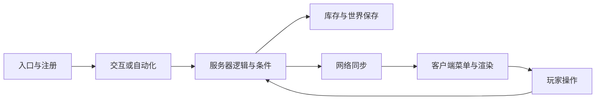

# Minecraft Java 模组升级与测试

[English](MOD-UPGRADE-AND-TESTING.en.md)

本文面向维护 Minecraft Java 模组、依赖库和模组组合的开发者，讨论跨 Minecraft、加载器及依赖版本的迁移方法。示例取自一次 Minecraft 26.3 / NeoForge 迁移；API 名称和生命周期须按目标版本核对。文档基线为 2026-11-04，项目案例对应 `0.3.0-alpha.3`；实际分发方式、仓库可见性及来源许可见 [发布说明](RELEASE.md) 和 [第三方声明](../THIRD_PARTY_NOTICES.md)。

## 1. 先确定迁移边界和功能基线

记录旧版可工作的组合，再固定目标组合。一个模组能编译，通常只覆盖了 Java 类型检查及构建任务实际执行的检查；安装后的注册、类加载、持久化、网络和渲染还需要运行证据。

| 项目 | 应记录的内容 |
| --- | --- |
| 游戏与加载器 | Minecraft、Fabric / Forge / NeoForge 的准确版本，物理客户端与专用服务器 |
| Java 与构建 | JDK、Gradle wrapper、插件、映射及编译目标；实际执行的任务 |
| 依赖 | 上游或分支、提交或版本、下载来源、SHA-256、必需或可选、编译期或运行期 |
| 打包 | source sets、排除项、Mixin 配置、元数据、嵌套 JAR、重复类和资源 |
| 配置与数据 | 默认配置、服务器配置、资源包和数据包优先级、旧存储格式 |
| 功能基线 | 已工作的配方、机器、存储、移动结构、客户端表现、世界生成与兼容组合 |
| 测试世界 | 新建世界或获准的副本、来源、配置、种子及副本的哈希清单 |

从一条可观察的功能链开始排查，确认每个环节的调用者、运行侧和生效条件：



例如机器不产物时，先区分配方未加载、库存未暴露、动力不足、处理器未注册、tick 未运行和输出受阻。注册表里有方块，只证明了链条的一部分。确认旧版原本支持该功能后，才把差异记为迁移回归。

## 2. 找到实际编译、打包和加载的代码

依次核对构建脚本、source sets、生成源、排除规则、模组元数据和最终 JAR。目录名只能提供线索：多加载器工程可能将 `src/neoforge/java` 编入目标包，而同名的 `src/main/java` 文件仍留作其他平台或参考。修改未参与编译的副本不会改变运行行为。

检查加载器入口、注册事件总线、Mixin 配置及可选依赖入口是否进入最终包。必需依赖应有正确版本范围；`compileOnly`、兼容桩和本地替代库需要与实际运行依赖分别登记。JAR 内嵌依赖也参与类解析，应检查重复类、服务描述文件、Mixin 和资源覆盖。

运行时的 `NoSuchFieldError`、`NoSuchMethodError` 和 `AbstractMethodError` 属于二进制接口线索。比较调用方字节码与实际依赖中的字段、方法描述符、静态性和可见性；只看源码方法名容易漏掉参数、返回值或字段变方法的差异。

本次迁移遇到的具体例子是 `FMLEnvironment.dist` 已被目标加载器的 `FMLEnvironment.getDist()` 替代。兼容桩若仍暴露旧字段，编译可以通过，执行客户端音效路径时仍会崩溃。下面仅示意该目标版本的调用方式，客户端执行封装仍须保持延迟求值和物理侧隔离：

```java
// 示例：须确认目标加载器实际提供 getDist()。
if (FMLEnvironment.getDist() == Dist.CLIENT) {
    factory.get().run();
}
```

补这一处调用时，应保留原有服务器启动、停止和模拟器生命周期。全局替换其他模块的同名工具或修改 tick 注册会扩大验证范围。[实际客户端封装](../modules/create-electro-energetics-adapted-263/src/neoforge/java/com/george_vi/electroenergetics/foundation/ClientExecution.java)

Mixin 迁移还要核对完整目标描述符、`@At`、ordinal、slice、局部变量和字段声明类型。Accessor 应匹配声明类型；放宽 `require` 或关闭 remap 可能让缺失注入静默发生。继承结构和执行时机变更时，要重新确认注入是否仍覆盖原功能。

## 3. 注册、运行侧和依赖生命周期

把公共注册、服务器逻辑、物理客户端注册和世界实例生命周期分开。集成服务器仍有逻辑服务器线程；仅在单人客户端成功启动的代码，可能在专用服务器加载客户端类时失败。客户端专用类应从加载器提供的客户端入口进入，公共静态初始化也要检查是否间接引用了它们。

注册对象通常使用延迟 supplier。只能在目标注册阶段完成后取值；提前缓存值、手动解冻注册表或重复注册会掩盖真正的顺序问题。模型、渲染器、菜单、网络接收器、能力或资源处理器、机器 tick 系统分别确认注册，不能从一个注册成功推断其他系统已接入。

方块实体恢复数据时，`level` 可能尚未绑定。读取时先恢复数据，依赖世界的查询、光照重算和邻居通知放在绑定世界后的初始化阶段，并确认重载后也会执行。网络处理应核对方向、线程、服务器权限及当前菜单或实体身份。

可选依赖分别测试缺失和存在的组合。以最小基础依赖运行 A、运行 B、再运行 A+B，能缩小依赖或 Mixin 冲突范围。兼容层必须保留原方法的调用约定，例如返回“已接收数量”与返回“剩余物品”的差异，以及模拟、提交、回滚和方向限制。

## 4. 库存迁移：给模组自己的数量建立边界

大容量库存需要区分物品身份与逻辑数量。物品身份包含注册 ID 和组件；模组私有字段保存超出普通栈上限的数量，进入原版物品栈 Codec、玩家背包、箱子、菜单槽和容器组件时遵守各自约束。修改原版全局 Codec、全局栈上限或所有菜单同步来容纳一个模组的库存，会影响其他存储和网络路径。

下面是私有存储格式的简化示例，普通物品原型数量为 1，`amount` 记录逻辑数量；它只适用于声明此格式的模组：

```json
{
  "StorageFormat": 1,
  "Size": 1,
  "Entries": [
    { "item": { "id": "minecraft:diamond", "count": 1 }, "amount": 4096 }
  ]
}
```

读取时验证格式版本、槽位范围、条目数量、数量上下界，以及空原型与零数量是否一致。写入时保留组件和槽位顺序。旧格式迁移应有明确的来源识别和幂等性，未知版本或冲突数据应报告并保留，不能直接当作空库存。私有持久化 Codec 与网络 Codec 也需分别核验注册表上下文和大小限制。[私有格式实现](../modules/create-storage-adapted-263/src/main/java/net/fxnt/fxntstorage/inventory/StorageContents.java)

菜单同步需要同时处理模组库存的逻辑数量、原版玩家槽、游标栈和远端状态哈希。把模组数量传输放在限定路径内，并保持原版槽的正常同步，能减少拖放、Shift 点击或重进后物品回弹。[菜单同步实现](../modules/create-storage-adapted-263/src/main/java/net/fxnt/fxntstorage/inventory/StorageMenuSynchronizer.java)

库存变更至少覆盖以下状态：

- 空库存、普通数量、容量边界和跨普通栈上限的数量；过滤器、带组件物品及相似 ID 的不同物品。
- 模拟后状态不变；提交后数量正确；拒收、部分接收、输出堵塞和回滚时物品仍有确定归属。
- 各方向自动化、直接交互、Shift 点击、拖放、游标栈，以及原版玩家背包和箱子。
- 保存退出、进程完全结束、独立 JVM 重进；比较物品身份、组件、数量、槽位和过滤器。客户端菜单和服务器持久化分别验证。

对纯搬运操作，按物品 ID 与组件分组检查守恒：

$$
Q_{\mathrm{初始}}+Q_{\mathrm{外部输入}}
=Q_{\mathrm{最终库存}}+Q_{\mathrm{输出或掉落}}.
$$

加工测试则按配方列出输入消耗和各项产出。数量测试要覆盖溢出边界；流体单位转换只有在两侧单位契约已确认后才能进行，容量元数据与实际存量须分开。

## 5. NBT、数据组件与 Ponder 虚拟世界

普通世界保存、网络包、资源模板和 Ponder 内存备份可能使用不同格式。先定位数据来源与读写链，再确定迁移入口。资源模板中遗留的旧 NBT，可以在模板加载边界转换；这类问题通常无需改变真实世界方块实体的保存格式或通用物品、流体 Codec。

一个可审查的适配器应限定注册 ID、字段、旧格式特征和允许的键集合，并保证再次执行结果不变。保留合法新格式、无关附加数据及互相冲突的两种表示，便于报告和进一步处理。以下是已确认的实例；字段规则不能扩展为全局 NBT 替换：

| 来源与症状 | 限定转换 | 必须保留的内容 |
| --- | --- | --- |
| 旧模板的大容量库存无法解码 | 对确认的私有库存 ID 与旧字段生成对应私有格式 | 槽位、实际数量、物品组件、过滤器 |
| 机械臂或黄铜隧道反序列化 AIR 报错 | 仅 `create:mechanical_arm/HeldItem` 与 `create:brass_tunnel/StackToDistribute` 中，恰有 `id`、`Count` 两键且为 `minecraft:air`、整数 0 或 1 的旧栈，改为 `{}` | 非 AIR、新格式、额外键、其他数量与冲突数据 |
| 旧流体栈字段与目标格式不同 | 按确认的容器和字段转换 ID、数量及组件 | 药水效果、瓶型、原数量；容量信息独立处理 |
| 控制器位置或材料字段结构改变 | 仅适配确认的方块实体 ID 和对应字段 | 位置语义、方向、材料身份及无关元数据 |

[旧物品占位适配器](../modules/create-aeronautics-adapted-263/simulated/src/main/java/dev/simulated_team/simulated/ponder/LegacyPonderTemplateItems.java) 使用上述 AIR 规则。若 Ponder 创建备份时又产生旧结构，还需在它自己的内存备份边界做同样受限的处理；[备份适配入口](../modules/create-aeronautics-adapted-263/simulated/src/main/java/dev/simulated_team/simulated/mixin/new_ponder/PonderLevelBackupMixin.java) 不改变真实世界的保存行为。

静态测试可以枚举模板、比较变更前后字段、验证未知格式保留及重复转换结果。动态测试还要确认虚拟世界恢复、脚本修改、镜头渲染和备份恢复。Ponder 可以手动设置动力速度而没有真实动力源；渲染侧在确认无来源时使用合理中性因子，保留有来源时的计算，可避免为展示场景修改全局动力网络。

## 6. 渲染迁移：管线、PiP 与纹理生命周期

沿数据提取、渲染提交、顶点写入、材质、图集和输出目标逐层核对。延迟提交的渲染路径应使用该帧的数据快照，不能假定提交时的可变对象在绘制时仍有相同状态。顶点格式、shader 输入、采样器、uniform 绑定、混合、深度、剔除和输出 attachment 都属于同一个契约。

世界画面、物品预览、Ponder 或其他画中画（PiP）目标可能具有不同 attachment 数量。只在主世界中测试，容易遗漏预览窗口的管线校验错误。26.3 的一个火焰管线实例需要使颜色输出与主世界和 PiP 实际提供的目标一致；不能把其他管线的多目标布局直接套入。[目标版本管线示例](../modules/create-aeronautics-adapted-263/aeronautics/src/main/java/dev/eriksonn/aeronautics/index/client/AeroRenderTypes.java)

纹理文件存在，还需要完成 sprite shift 注册和图集装载。若对象第一次在渲染中懒初始化，而图集拼接已结束，`SpriteShiftEntry.getOriginal()` 仍可能为空。本次绳索故障通过在物理客户端构造入口提前调用 `SimSpriteShifts.init()` 修复；已有 Catnip 图集事件继续在资源重载时更新 sprite。专用服务器不加载此客户端入口。[客户端初始化](../modules/create-aeronautics-adapted-263/simulated/src/neoforge/java/dev/simulated_team/simulated/neoforge/SimulatedNeoForgeClient.java)

核验应同时覆盖首次加载和 F3+T 资源重载：等待重载完成，确认 original 与 target sprite 均存在，再实际显示对象。测试使用 `Minecraft.reloadResourcePacks()` 时，也要等待其异步完成。随后查看真实 GUI、相关错误日志和截图；单纯跳过空 sprite 的绘制会留下缺失的对象。检查同一注册入口的全部 sprite shift，以及资源路径、大小写、图集目录覆盖和材质缓存重建。

## 7. 动画完成条件与脚本尾段

区分预定持续播放的背景指令与应该结束的操作。旋转背景可以持续到场景关闭；收到减速或停止请求后，测试应等待实际停止。持续状态应由具体类、字段和参数判断，不能把所有超时或同一模组的指令都视为正常。

停止判定应对应被控制的量。钻头停转后可以保留任意最终角度，用绝对旋转姿态长度接近零判断完成，会把已停止的动画永久留在队列中。本次目标方块实体会在低速阈值处把角速度明确归零，因此指令在 `startSlowing && currentRotationRate == 0` 时结束，并保留最终姿态。其他实现若仅渐近趋零，应按其单位、阈值和稳定条件定义判定。[停转指令实现](../modules/create-aeronautics-adapted-263/offroad/src/main/java/dev/ryanhcode/offroad/content/ponder/instructions/ChangeBoreheadAndContraptionSpeedInstruction.java)

测试时间轴的可计数部分结束后，仍要执行真实活动队列中的有限指令。任意 seek 到末尾、看到 `markAsFinished` 或达到估算时长，都可能漏掉清空库存、停转、淡出和收尾脚本。对有限尾段设置有诊断信息的上限，超限时报告类名、关键状态及停止请求是否已发出。已确认的持续背景可按精确条件排除；带停止控制器或已收到停止请求的同类实例仍需完成。

动画恢复还要覆盖无目标、前一个索引为 `-1`、空列表和目标消失。仅客户端动画分支需要的边界判断应留在该分支，保持服务器行为和保存格式。

## 8. 世界生成、预生成与补生成

世界生成要核对注册对象、configured feature、placed feature、生物群系或维度挂接、加载条件和数据包覆盖。物品已注册、配方可用或区块预生成完成，各自验证的是不同环节。用满足高度、群系和维度条件的新增区块验证实际生成，并记录种子、区域、配置及统计方法。

普通生成规则作用于新生成区块。旧区块需要明确设计的补生成（retrogen）流程：按区块记录版本或完成状态，操作幂等，限制处理范围与每 tick 工作量，并处理区块重载和中断恢复。迁移方块实体存储与给旧区块补矿属于两种变更，应分别设计和测试。

测试只使用新建世界或明确获准的独立副本，不打开或修改原存档。副本记录来源与哈希，保留迁移前检查点。预生成任务还需验证暂停、恢复、磁盘余量、目标范围及完成标记；完成标记应由实际区块状态支持。删除原区域文件重新生成会丢失建筑和数据，不能作为默认升级步骤。

## 9. 按变更选择测试，保留覆盖边界

测试从较便宜的检查推进到受影响的运行路径。每层记录实际执行了什么；跳过、条件不满足和缺少环境分别列出。

| 层次 | 主要问题 | 合适的证据 |
| --- | --- | --- |
| 静态与构建 | 源集、依赖、元数据、资源、Mixin、编译和打包是否一致 | 构建结果、JAR 内容、ABI 检查、哈希 |
| 客户端与专用服务器启动 | 运行侧、注册和实际依赖能否加载 | 两侧日志、注册断言和退出状态 |
| 功能与组合 | 输入、条件、处理、输出及兼容分支是否工作 | 确定性夹具、状态或数量断言、少量组合样本 |
| 持久化与同步 | 保存后是否可恢复，客户端与服务器是否一致 | 独立 JVM 重进、数量与组件比较、菜单操作 |
| 渲染与资源重载 | 目标、材质、动画和图集生命周期是否正确 | 真实 GUI、截图、日志、重载前后断言 |
| 世界生成 | 满足条件的新区块和获准补生成是否正确 | 区块与方块统计、版本标记、中断恢复 |

Ponder 的默认采样单位是**同一模组中相同实际逻辑的一组程序**。按 storyboard 实现和有意义的捕获参数分组；仅物品或材料别名不同的条目选择一个代表。回调对象身份、重复场景名和跨 JVM 的列表索引都不能单独充当语义分组依据。渲染方式、数据格式、配置分支或本次修改行为明显不同的条目保留独立样本。

每次变更验证受影响的代表组，再加少量跨模组冒烟样本。完整注册索引和模板扫描成本较低，可以保留全量静态检查。无关 JAR 的哈希变化用于记录新的输入，不应单独触发全包回放。测试框架本身改变、共享渲染或序列化基础设施改变、分组依据失效等情况，才根据影响重新扩大范围，并记录理由。

代表清单至少记录：模组、实现、关键参数、同组别名、所选场景、选择原因、输入哈希、执行状态和未覆盖分支。新扫描后重新核对选中程序，避免把旧索引解释为新列表中的同一个场景。脚本目前按索引和数量选取程序，语义分组仍需由审查者记录。

一次历史 Ponder 回归记录了 **389 个程序、3,458 个时间采样点、38,592 个 GUI 帧**，相关错误为零，并覆盖指定内容、有限脚本收尾、资源重载及正常保存退出。这些数字描述该批输入与采样范围；帧数也不表示逐帧像素或每个自然时间点都已检查。多人、长期负载、全部配置、可选模组组合和全部玩法仍需各自的验证。[历史审计与局限](PONDER-AUDIT-20261104.md)

Ponder 可能捕获异常、记录 ERROR 后继续运行。通过条件应同时检查进程退出、超时、探针断言、预期与实际任务、相关 ERROR 和输入哈希。日志解析器应支持属性顺序变化，遇到预期格式缺失时明确失败；确需排除的环境消息用精确 logger 与消息匹配，并记录理由。

## 10. 从症状到核验

| 症状 | 定位 | 修改方向 | 核验 |
| --- | --- | --- | --- |
| `UnsupportedClassVersionError` | 实际启动 JDK、class 版本、工具链 | 统一目标 JDK 与运行环境 | 构建及实际两侧启动 |
| `NoSuchFieldError` / `NoSuchMethodError` | 调用方字节码、运行依赖及嵌套 JAR | 按真实 ABI 改调用或对齐依赖 | 触发原崩溃路径；检查重复类 |
| Mixin 无目标或注入失败 | 完整描述符、执行点、字段声明类型 | 更新精确目标与注入位置 | 启动及对应行为断言 |
| 注册冻结、重复 ID 或 supplier 为空 | 注册总线、取值时机、重复入口 | 恢复目标生命周期 | 首次启动、重进、专用服务器 |
| 服务器加载客户端类 | 公共入口和静态初始化依赖 | 使用物理客户端入口 | 无图形环境的专用服务器启动 |
| 库存解码失败、数量丢失 | 私有与原版 Codec 边界、版本及组件 | 限定私有格式与迁移 | 守恒、原版槽、独立 JVM 重进 |
| 菜单物品回弹 | 服务器状态、数量包、原版槽和哈希 | 修复同步协议或限定菜单路径 | 点击、拖放、Shift 点击和重连 |
| Ponder 模板恢复或脚本失败 | BE ID、具体字段、旧格式、备份来源 | 局部且幂等的模板适配 | 静态保留断言及受影响场景 |
| 有速度却无 source 的虚拟渲染失败 | Ponder 手动状态和渲染调用契约 | 无来源时中性渲染分支 | 无来源与正常有来源场景 |
| 顶点或 attachment 校验失败 | shader、布局、材质与实际目标 | 对齐管线契约 | 世界、物品或 PiP 受影响路径 |
| sprite 为空或重载后丢纹理 | 资源路径、注册与图集事件顺序 | 首次拼接前注册，重载时更新 | 首次显示、F3+T、再次显示 |
| 停转后尾段一直超时 | 停止请求、角速度与绝对姿态 | 使用物理状态的真实完成条件 | 非零最终角度、停转及重置 |
| 机器已放置但不工作 | 配方、配置、能力、tick 与条件 | 补齐断开的调用链 | 输入到输出及堵塞状态 |
| 新矿物只在物品栏出现 | 生成挂接、条件、旧区块 | 修正数据与挂接；单独设计补生成 | 合适的新区块与获准副本 |

## 11. 可用的检查命令与本仓库测试入口

以下 PowerShell 命令分别用于通用检查和本仓库现有工具。执行前确认当前位置与工具版本；构建和运行测试应按项目要求串行安排。

### 通用检查

在包含 Gradle wrapper 的单模组根目录执行：

```powershell
java -version
.\gradlew.bat --version
.\gradlew.bat build
```

检查已选 JAR 和依赖的实际内容；交互输入可使用自己的相对路径：

```powershell
$modJar = Read-Host 'Mod JAR path'
$dependencyJar = Read-Host 'Loader dependency JAR path'
Get-FileHash -LiteralPath $modJar -Algorithm SHA256
jar tf $modJar
javap -p -s -classpath $dependencyJar net.neoforged.fml.loading.FMLEnvironment
```

最后一行是 NeoForge 示例；其他加载器或版本应换成实际需要核对的类。必要时用 `javap -c` 检查调用方指令，确认它读取字段还是调用方法。

### 本仓库入口

在仓库根目录查看实际参数，选择受影响模块构建：

```powershell
python -X utf8 -B scripts/build.py --help
python -X utf8 -B scripts/build.py --only storage
python -X utf8 -B scripts/test_gameplay.py --help
python -X utf8 -B scripts/test_all_ponder_client.py --help
```

运行探针需要已编译的测试模组、匹配的运行包，以及本地配置的启动模板。Ponder 脚本还依赖已建立的项目测试种子世界和客户端夹具；这些机器本地输入不随公开源码分发。全新检出应先按项目运行说明准备环境，不能直接假定下面的运行命令已具备前提。[构建入口](../scripts/build.py)、[玩法入口](../scripts/test_gameplay.py)、[Ponder 入口](../scripts/test_all_ponder_client.py)、[隔离夹具实现](../scripts/test_three_addons.py)

存储变更使用已有的存储玩法组；该入口分创建阶段和独立 JVM 重载阶段，运行结果仍要检查实际断言与覆盖项：

```powershell
python -X utf8 -B scripts/test_gameplay.py --group storage
```

Ponder 示例先生成新扫描，再对照 `render_jobs` 选择一个代表索引。`--storage` 指向项目 `runtime/` 下带匹配 `package-manifest.json` 的候选运行包中的 Storage JAR；额外候选模组可通过现有 `--candidate-mod` 参数同时传入扫描和渲染命令。

```powershell
$storageJar = Read-Host 'Candidate Storage JAR under runtime/'
python -X utf8 -B scripts/test_all_ponder_client.py scan --storage $storageJar
$scan = (Get-Content -LiteralPath .local/last-all-ponder-scan.json -Raw | ConvertFrom-Json).result
$jobIndex = [int](Read-Host 'Representative index in this scan render_jobs')
python -X utf8 -B scripts/test_all_ponder_client.py render --storage $storageJar --scan $scan --start $jobIndex --limit 1 --reload-resources
```

运行失败时先检查前提和报告，避免继续使用旧扫描或旧结果。这个重载探针还检查特定绳索 sprite 的 original / target；其他模组的图集和材质需要各自的断言。历史全量批处理工具可用于有明确理由的广泛回归，日常修改按代表清单执行。

## 12. 发布前检查源码、素材和可达历史

代码与素材可以适用不同许可。逐模块保留上游身份、来源提交或快照哈希、许可证、版权和修改说明，再检查实际发布物。某模块代码采用 MIT，并不能据此发布其 ARR 美术资源；带非商业或其他限制的依赖，也需要分别判断分发条件。本仓库的许可入口是 [第三方声明](../THIRD_PARTY_NOTICES.md) 和 [许可证目录](../LICENSES/)。

检查所有 `assets/<namespace>/`，包括放在其他模组命名空间中的兼容贴图、模型、声音、字体和图标；同时检查根目录资源、数据生成产物和下载缓存。依赖 JAR 可能以嵌套包进入最终制品，须递归核对其资源与许可。下面的只读示例列出每层 JAR 的素材命名空间和嵌套 JAR；它只提供清单，许可判断仍须逐项完成。

```powershell
@'
import io, sys, zipfile
from pathlib import Path

def inspect(source, label, depth=0):
    if depth > 8:
        raise RuntimeError("Nested JAR depth exceeds audit limit")
    with zipfile.ZipFile(source) as archive:
        names = archive.namelist()
        namespaces = sorted({n.split('/')[1] for n in names
                             if n.startswith('assets/') and len(n.split('/')) > 2})
        print(label, "assets namespaces:", ", ".join(namespaces) or "(none)")
        for name in names:
            if name.lower().endswith('.jar'):
                inspect(io.BytesIO(archive.read(name)), label + "!" + name, depth + 1)

inspect(sys.argv[1], Path(sys.argv[1]).name)
'@ | python -X utf8 - $modJar
```

工作树清理与历史审计分别进行。所有可达分支和标签、旧提交、旧 Release 附件及下载包都可能仍含 ARR 素材、机密或个人路径。删除最新版本中的文件不会清除这些副本；已有历史和 Release 仍含受限素材时，不能直接把原私有仓库改为公开。历史重写或建立独立的公开快照需要单独确认方案，并保留来源与本地源工作区。

下列 Git 命令可列出工作树状态、现有 refs 和可达对象；检查范围还应覆盖托管平台上单独保存的附件：

```powershell
git status --short
git for-each-ref --format='%(refname)'
git rev-list --objects --all
```

发布候选记录应包含版本与提交、运行 JAR 哈希、测试组及未覆盖范围、数据格式变化、迁移与回退方式、已知问题，以及许可证和素材处理结果。公开文档与附件去除本机绝对路径、机器用户名、凭证和私有记录。受限素材若允许由使用者从上游取得，应以固定来源和哈希的本地引导流程处理，并核验上游条款；分发包中不附带未经许可的副本。
