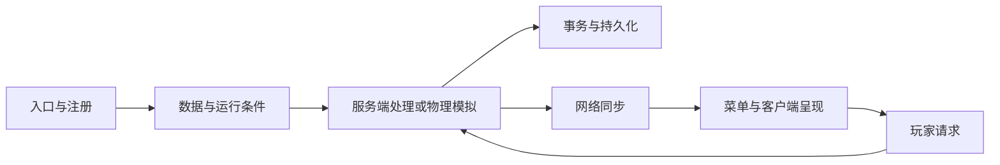

# Minecraft Java 模组升级与测试

[English](MOD-UPGRADE-AND-TESTING.en.md) · [本项目开发过程与实现](DEVELOPMENT-OVERVIEW.md)

本文讨论从现有源码建立目标版本模组、迁移加载器与依赖、保持玩法和数据语义，以及验证整套组合的方法。适用于 Fabric、Forge、NeoForge 等工程；具体 API 按目标版本核对。文档核对日期：2026-11-04。

阅读主线为：来源与功能基线 → 源码恢复 → 构建及依赖 → 生命周期与冲突 → 资源、存储、网络和物理 → 客户端 → 分层验收与分发。章节按工程职责组织，日志长度和测试计数用于说明各自的证据范围。

## 1. 固定目标环境，同时建立功能清单

迁移边界包括 Minecraft、加载器、Java、构建插件、映射、前置模组分支、客户端/专用服务器和可选联动。同一游戏版本的两个 Create fork，也可能提供不同的包名、基类、注册器、事务和渲染接口。

| 基线 | 应记录的内容 | 后续用途 |
| --- | --- | --- |
| 来源 | 仓库、提交或明确工作树快照、文件 hash、许可与版权 | 区分原实现、本地修改和二进制恢复 |
| 平台 | MC、loader、JDK、Gradle/插件、映射、必需依赖及嵌入库 | 复现编译与真实类加载 |
| 功能 | 注册内容、机器输入输出、保存、菜单、移动结构和可选联动 | 发现能启动但未接入的功能 |
| 数据 | ID、组件、数量单位、配方、世界数据和已支持旧格式 | 制定迁移与回归边界 |
| 证据 | 旧版行为、目标产物 hash、执行过的测试及待测项 | 判断迁移回归 |

从可观察的功能链寻找第一个缺失的结果：



物品存在说明注册链已执行；机器消耗输入但没有产出，要继续查配方和处理器；服务器状态已变化而画面停在旧值，要查同步与渲染。先确认旧版原本支持该功能，再判断是否为迁移回归。

## 2. 只有旧源码和新发布包时，恢复必要差异

先确认源码与发布包的关系。公开源码落后于发布版本时，可以保留公开源码作为维护底座，用相近版本和目标版本二进制缩小变化范围。恢复代码继续保留来源与许可，明确它是重建实现。

1. 固定公开源码、比较参照 JAR 和目标 JAR，记录版本与 SHA-256；输入还包括嵌套库与映射。
2. 比较类集合、字段和完整方法描述符，将真实指令/控制流变化，与符号、编译器、调试信息和自动生成方法的差异分开。
3. 对真正变化的方法反编译，阅读调用者、异常处理、事务及目标 API，再将必要修改合并回正式源码。
4. 检查同名接口的语义：返回已接受量还是剩余量、异常是否回滚、修改副本还是原对象，都影响玩法。
5. 留下“来源类/方法 → 本地文件 → 修改理由 → 编译/运行证据”的映射。反编译结果与分析缓存单独保存。

本项目的 Create 恢复使用 26.2 / 0.996 公开源码，以及 26.2 / 1.31、26.3 / 1.31 比较输入。历史分析将 1,122 个变类中的 310 个归为真实指令、控制流或方法集合变化；该统计属于当时固定输入，不能套用于后续产物。公开源码包未附完整原始分析缓存。[输入与许可](SOURCE-AND-LICENSES.md)

[ResourceHandlerItemAdapter](../modules/create-adapted-263/src/main/java/com/simibubi/create/api/contraption/storage/item/simple/ResourceHandlerItemAdapter.java) 是行为恢复例子：提取量受单栈限制，替换时完整提取旧物、完整插入新物后才提交事务。单文件编译和方法指令比对证明该处结果；整套源码可构建及实际游戏运行要在后续阶段另行验收。

## 3. 对齐加载器、源集、依赖和生产命名空间

跨加载器需要迁移入口、事件总线、注册、资源能力、网络和服务实现。版本号及 TOML 只改变声明，运行侧工厂仍要接入目标实现。较高 MC 的 Fabric 参考与较完整的 NeoForge 功能树，可以按文件和职责融合可用迁移点；保留功能清单和各部分来源。

| 层次 | 检查或修改 | 预期效果 |
| --- | --- | --- |
| 构建 | Wrapper、插件、toolchain、sourceSets、生成资源、排除项 | 编译实际目标源码并保留必要资源 |
| 依赖 | fork、精确版本、签名、compileOnly/implementation/Jar-in-Jar | 编译与运行解析到同一契约 |
| 平台桥 | 入口、事件、ServiceLoader、能力和网络实现 | 原平台行为实际执行 |
| 成品 | 外部类、重复包、嵌入库、反射及资源引用 | 避免开发环境可用、成品加载失败 |

目录名只能提供线索，以有效源集为准。旧 datagen 和可选集成可以独立保留，但未进入默认运行包的代码不能列为已启用功能。编译桩须明确运行提供者并从发行包排除；正式兼容实现则应保留方法语义和许可。

同名同版本依赖也可能 ABI 不同。Registrate 分支的参数类型需要由实际 JAR 确认，再生成专用编译桥或对齐源码；不要改写全局共享缓存。[构建入口](../scripts/build.py)、[共享平台](../gradle/create263-addon.gradle)

嵌入渲染库的迁移涉及类、元数据和必要资源引用。全局字符串替换可能损坏 shader 子目录、正则或同名方块 ID。本项目使用结构化 [IsolateFlywheel](../modules/create-adapted-263/scripts/IsolateFlywheel.java)，再由[打包检查](../scripts/package.py)拒绝外部类、未隔离引用和跨模组重复包。

按依赖顺序构建并共用真实 Create/Sable/Simulated 输出。共享 Gradle 缓存只允许一个写入者；基础组合先验收，再逐组加入功能模块，使故障能关联到明确变化。

## 4. 注册、运行侧、生命周期与 Mixin 冲突

公共注册、物理客户端、服务器启动/关闭和世界 tick 是不同生命周期。延迟 supplier 在合法阶段求值；模型、声音和按键从客户端入口进入。公共类的参数、静态字段和初始化也可能加载客户端类，单加运行时分支未必能隔离。

机器有方块、网络有数据，仍可能缺服务器处理器。模拟系统需要真实启动、更新和停止钩子；缺 executor 时下游可能提前返回。测试让正常游戏入口启动它，再核验输出和关闭清理。[电力生命周期案例](GAMEPLAY-VALIDATION-26.3.md)

Mixin 应检查完整描述符、调用点、字段声明类型、ordinal、slice、局部变量与映射。另一模组覆盖目标方法后，旧注入点可能消失。Sable 广播覆盖与铁道相机定位的兼容，需要同时保留子空间距离和相机位置，不能只让注入不报错。[早期联合检查](VALIDATION-v0.1.0-alpha.1.md)

关闭注入、放宽 `require` 或返回固定成功值时，应明确丢失了哪些行为。条件化兼容还需检查不含相关依赖的基础路径。

## 5. 物品、流体和能量：迁移操作语义

替换 handler 前，明确资源身份、单位、容量、方向、返回值、模拟、提交与通知。同 ID 的不同组件可能代表不同资源；容量元数据与实际存量也有区别。

一次操作的全部参与者应在同一事务中作一致决定。下面是流程示意，具体 API 按目标版本实现：

```text
打开可回滚事务
  从真实容器访问器抽取输入
  向目标插入相应资源
  两边完整接受：写回容器结果并提交
  拒收、提取不足或容量不足：放弃事务
根事务提交后发业务通知
```

背包或可重复使用罐把内容放在组件中时，应通过调用者的真实 `ItemAccess` 交换结果。同一个物理后端的不同侧面、控制器和接口视图共享快照；压缩链、过滤、容量等派生状态也须一起回滚。[容器供液](../modules/create-liquid-fuel-adapted-263/src/main/java/com/forsteri/createliquidfuel/core/BurnerStomachHandler.java)、[背包交换](../modules/create-storage-adapted-263/src/main/java/net/fxnt/fxntstorage/inventory/StorageBackpackTransfer.java)

旧模拟协议还需阅读调用者。Create 机械臂会观察工作副本的数量变化来判断模拟接受量；修改这份临时副本与提交真实世界是两个动作。把所有模拟调用简化为不修改任何对象，会破坏原协议。

对纯搬运，按资源 ID 与组件分组检查守恒：

$$
Q_{\mathrm{初始}}+Q_{\mathrm{外部输入}}
=Q_{\mathrm{最终存量}}+Q_{\mathrm{输出或掉落}}.
$$

$Q$ 使用该类资源的固定单位；流体、能量、转速和力矩分别核对 API。覆盖成功、部分接受、拒收、根/嵌套回滚和六面自动化。游戏操作的失败对照应从合法物品状态开始，不应强造超过栈上限的输入来迎合错误预期；刻意构造非法编码属于另一类输入校验测试。[真实交换失败案例](porting-notes/FLUID-26.3.md)

## 6. 持久化迁移与模组私有库存

先区分世界保存、物品组件、网络、资源模板和临时备份。现代 ValueIO、Codec 或模板 API 需要注册表上下文；旧保存方法仍能编译，不代表它仍被引擎调用。

高数量库存将物品身份和逻辑数量分开：数量为 1 的完整原型保存组件，额外字段保存模组数量；进入原版背包、箱子、光标和容器组件时服从原有规则。本项目采用 `fxntstorage:storage_contents`，未采用扩大全局计数的候选。[私有格式](../modules/create-storage-adapted-263/src/main/java/net/fxnt/fxntstorage/inventory/StorageContents.java)

下面仅示意格式设计，字段和容量以实现为准：

```json
{"StorageFormat":1,"Size":1,"Entries":[{"item":{"id":"minecraft:diamond","count":1},"amount":4096}]}
```

读入时整份校验版本、槽位、数量与组件，再一次替换活库存。迁移应识别旧来源、幂等处理并保留未知输入，不能默认成空库存。背包等级、工具格、筛选格和对外物品槽分别限制。

验证方块、物品背包、掉落/放置、挂载/拆卸及磁盘重开；比较身份、组件、数量、过滤和容量。内存往返与独立 JVM 是不同证据。新格式保存通过，也不能推导旧格式自动迁移安全。

## 7. 网络、菜单与权限

检查 payload 注册、两端 codec、字段顺序、注册表、方向、线程、对象身份与权限。服务端保持权威状态；只修改客户端界面不能实现机器或配方查询。

Storage 用专用消息发送私有槽与初始状态，玩家槽、光标和 dataSlots 继续委托原生同步器，并保留 containerId、stateId、槽位及原生点击 hash 校验。[同步实现](../modules/create-storage-adapted-263/src/main/java/net/fxnt/fxntstorage/inventory/StorageMenuSynchronizer.java)

测试打开、点击、Shift 点击、拖放、换背包、重连和过期请求，比较两端与光标状态。压缩配方等查询要经过真实请求/回复及当前配方管理器。单人集成服务器的协议通过，不自动覆盖远程专服传输。

管理命令不可用时，先查环境、权限、作弊设置及注册日志，再判断加载器或模组是否改变了原版命令。

## 8. 配方、标签、配置和世界生成

沿“生成或静态 JSON → 条件 → Codec → 管理器 → 实际机器”核对。目录、Ingredient、结果组件、掉落、进度和自定义序列化器都可能变化；Java 构建不能替代实际数据加载。

| 问题 | 修改位置 | 应核验的行为 |
| --- | --- | --- |
| 默认组件未绑定 | 延迟模板、对象构造和缓存发布时机 | 注册完成后构造完整 Stack |
| 配方/掉落缺失 | datagen、静态资源、条件及 serializer | 数量、概率、标签与条件顺序保留 |
| reload 留下旧规则 | listener、配置读取、缓存替换 | 新规则出现、删除规则消失 |
| 枚举/默认值变动 | 兼容读取与保存 | 旧值处理明确，默认玩法保持 |
| 只有矿物图标 | feature 或虚拟矿脉数据、生成条件 | 满足条件的新区块有实际内容 |

holder 已注册不代表默认组件已绑定，`CommonSetup.enqueueWork` 也不能代替实际时序核对。配方可保存 `ItemStackTemplate`/`FluidStackTemplate`，待使用时构造 Stack；资源注册可先冻结身份，组件可用后再校验并发布缓存。

液体燃料测试通过临时数据包、实际重载和旧规则删除核验配置行为；水燃料只属于夹具，不属于默认游玩规则。[三附属验证](VALIDATION-v0.2.0-alpha.1.md)

矿物方块生成与虚拟矿脉是不同实现。前者检查 configured/placed feature 和地形挂接；后者还可能依赖 attachment、种子和机器配方。普通规则作用于新生成区块；旧区块补生成须另设计版本标记、幂等、处理预算和中断恢复。预生成不会自动完成旧数据迁移。

## 9. 物理系统与移动结构

物理扩展涉及服务器模拟、原生库、局部/世界坐标、身份、碰撞、附件保存及客户端呈现。确认后端 ABI、平台加载、服务与执行线程；空实现不能证明真实力学功能。

连杆需要两端物理体、局部锚点与生命周期。装配拆分、移动或合并后，旧 handle 可能失效，需要按身份重映射并重建；磁盘重载后也须重新绑定。[连杆实现与验证](../modules/transmission-linkage-adapted-263/docs/PORTING-26.3.md)

子空间渲染和广播距离使用各自坐标语义。模块可编译、模型可见、原生约束实际工作，应分开记录。测试先看有限状态、重力/碰撞、身份与约束，再看受控输入产生推进或运动，最后独立重载。[基础物理检查](VALIDATION-v0.1.0-alpha.1.md)

一次螺旋桨或液压夹具只覆盖该工况；复杂闭环、跨维度和长期多人负载仍需专项测试。

## 10. 客户端、渲染和演示环境

沿注册、状态提取、延迟提交、顶点格式、shader、图集和输出目标检查。需要跨阶段使用的数据应在提取时保存，绘制后恢复共享上下文。世界、物品、移动结构与画中画可能走不同路径；此为迁移检查方法，不表示所有旧渲染器均已完成同样重构。

文件存在还需要图集入口和初始化时机。RGB 旧颜色在 ARGB 路径可变透明，可选资源也可能在对应模组缺失时无条件加载。检查首次显示和 F3+T 重载，测试 `Minecraft.reloadResourcePacks()` 时等待其异步完成。

Ponder 是一种虚拟环境：旧模板按明确 ID/字段在加载边界转换，保留新格式、未知键和冲突数据；备份兼容留在备份入口，不改真实世界存储。无动力源、空前一索引等状态需要合法默认值。

有限动画的结束条件对应实际状态，例如角速度而非最终角度；持续背景另按设计处理。代表回归覆盖数据、绘制、有限收尾、日志与重载。AIR、流体、控制器字段和具体渲染修复见[思索迁移细则](PONDER-PORTING-NOTES.md)、[思索专题](PONDER-AUDIT-20261104.md)及[火焰管线](PONDER-FLAME-HOTFIX-20261103.md)。

## 11. 分层验证，并按风险选择样本

| 层次 | 要解决的问题 | 证据与边界 |
| --- | --- | --- |
| 来源/差分 | 修改来自哪里，恢复什么 | 固定输入、方法差异与来源 |
| 编译/打包 | 源集、ABI、元数据、命名空间一致 | 构建、JAR/嵌入库检查 |
| 联合启动 | 运行侧与组合冲突 | 注册、服务、正常保存退出 |
| 实际功能 | 输入、条件、处理、输出及单位正确 | 自然 tick、守恒、事务、原生约束 |
| 网络/持久化 | 操作、同步、独立重载一致 | 菜单、消息、组件与槽位 |
| 客户端 | 模型、GUI、动画与资源重载正常 | 受影响画面、断言、日志 |
| 分发 | 还原受测组合与对应源码 | 源码 hash、安装执行、JAR 条目 |

本项目由九个基础 JAR 扩展到十二、十八个直接 JAR。装配推进、供液钻井、约束重建、库存加工及真实电路负载回答不同问题；[开发总览](DEVELOPMENT-OVERVIEW.md)按阶段关联代码和证据。

负对照包括断电不产出、堵塞不扣料、事务放弃恢复状态、重新供能后继续工作。电力负载测试曾暴露漏接模拟器生命周期；仅检查电线与节点存在发现不了它。[深入玩法](GAMEPLAY-VALIDATION-26.3.md)

Ponder 在同模组、同脚本及有意义参数相同的组中取一个代表，物品/材质别名不重复。数据、渲染、配置或失败分支不同则补样本。事务拒收与提交、客户端与服务器、内存往返与独立 JVM，不能因属于同一模组而合成一个结论。

修改后回归受影响组及少量跨模块样本。无关 hash 变化只更新输入；共享接口、测试框架或语义分组发生实质变化才扩大范围。记录代表、输入 hash、断言、跳过和未覆盖分支。

通过条件包含预期任务、断言、超时、相关日志与正常保存退出。系统可捕获异常后继续运行，退出码 0 需结合 ERROR 与内容判断。环境日志排除精确限定。程序数、帧数和检查项不相加为功能覆盖率。

## 12. 从症状定位代码与功能缺口

| 症状 | 先看哪里 | 修改与核验 |
| --- | --- | --- |
| 字节码版本不支持 | 启动 JDK、toolchain | 对齐构建/运行，两侧启动 |
| 缺字段/方法 | 调用者字节码、真实依赖与嵌入库 | 修正完整 ABI，触发原路径 |
| split-package | 成品 Java 包、桥接和打包任务 | 隔离包，同步反射/注册调用 |
| 注册冻结或空 supplier | 入口、总线、求值顺序 | 延迟到合法阶段，首次与重进 |
| 服务器加载客户端类 | 公共参数、静态字段和构造器 | 提取客户端实现，专服启动 |
| Mixin 目标消失 | 描述符和其他模组覆盖 | 保留双方语义，基础/组合检查 |
| 方块不工作 | 注册处理器、tick、配方、配置、输出 | 修复首个断点，真实输入输出 |
| 电线存在但无动力 | 模拟器生命周期、线程、负载 | 自然 tick、断电恢复及停服 |
| 资源丢失/复制 | 物理 owner、快照、事务、余物 | 同一事务，守恒及回滚 |
| 重开丢库存/菜单回弹 | codec、原版边界、消息、状态 hash | 整份校验、点击/重连/重启 |
| reload 不生效 | schema、条件、动态注册、缓存 | 实际新旧规则切换 |
| 移动物理体断链 | 坐标、身份、handle、附件 | 重映射、原生运动、磁盘重载 |
| 矿物只在物品栏 | feature 或虚拟矿脉、条件 | 合适新区块，补生成另测 |
| 模型/界面透明或缺图 | 注册、ARGB、图集、条件资源 | 首次显示、联动条件与重载 |
| 预览失败或动画不停 | 模板、提取状态、管线、停止量 | 对应数据/绘制代表及尾段 |

## 13. 构建和测试入口

通用诊断在所选模块或依赖目录执行；类名是目标 NeoForge 示例：

```powershell
java -version
.\gradlew.bat --version
$modJar = Read-Host 'Mod JAR path'
$dependencyJar = Read-Host 'Dependency JAR path'
Get-FileHash -LiteralPath $modJar -Algorithm SHA256
jar tf $modJar
javap -p -s -classpath $dependencyJar net.neoforged.fml.loading.FMLEnvironment
```

需要时用 `javap -c` 查看调用指令。目标环境检查使用 `FMLEnvironment.getDist()`；旧字段兼容桩不能证明运行时仍有该字段。

完整准备见[README](../README.md#从源码构建)。以下为现有入口。先完成全部模块及依赖的首次构建，再重建受影响模块、探针并重新组装；测试读取组装后的产物。另需 Java 25、独立启动模板与测试夹具：

```powershell
python -X utf8 -B scripts/build.py --help
python -X utf8 -B scripts/build.py --only storage
python -X utf8 -B scripts/gradle_serial.py runtime-probe jar
python -X utf8 -B scripts/package.py
python -X utf8 -B scripts/test_gameplay.py --help
python -X utf8 -B scripts/test_gameplay.py --group storage
python -X utf8 -B scripts/test_gameplay.py --group processing
python -X utf8 -B scripts/test_gameplay.py --group power-logistics
```

`.local/config.json` 配置 `server_launch_template` / `client_template_directory` 等；源码包不附测试世界和客户端夹具。玩法入口新建世界、保存退出、独立 JVM 重开，联合客户端另见 [test_three_addons.py](../scripts/test_three_addons.py)。

思索的扫描、代表索引、资源重载入口和夹具说明见 [Ponder 迁移细则](PONDER-PORTING-NOTES.md)。

## 14. 源码、素材与可复现分发

从固定提交导出对应源码，保留上游身份、版权、各组件许可和恢复输入。代码、引用、原生库与素材分别核对；逆向恢复或换包名不会授予新许可。[来源与许可](SOURCE-AND-LICENSES.md)

检查全部 `assets/<namespace>/`、生成资源、嵌套 JAR、旧依赖与实际附件，按完整来源边界和资源锁过滤；子模块例外也可能覆盖根 `.gitignore`。工作树、跟踪文件、导出 ZIP 与可达历史分别审查。

串联构建输入、运行 JAR、安装器载荷与还原结果的 hash。源码 ZIP 按 Git 规范字节逐文件核验，安装器实际恢复固定资源后比较全部有效 JAR 条目。压缩和时间戳会改变整文件 hash，等价说明仍需列明实际变化。

记录版本/提交、测试组合、数据格式与迁移范围、通过行为和待测项。测试用新世界或获准副本，保留 hash 与迁移前检查点；世界、个人配置、缓存和协作记录不进入普通分发。回退使用更新前备份，不能把已写入新格式的世界直接交给旧版本。
